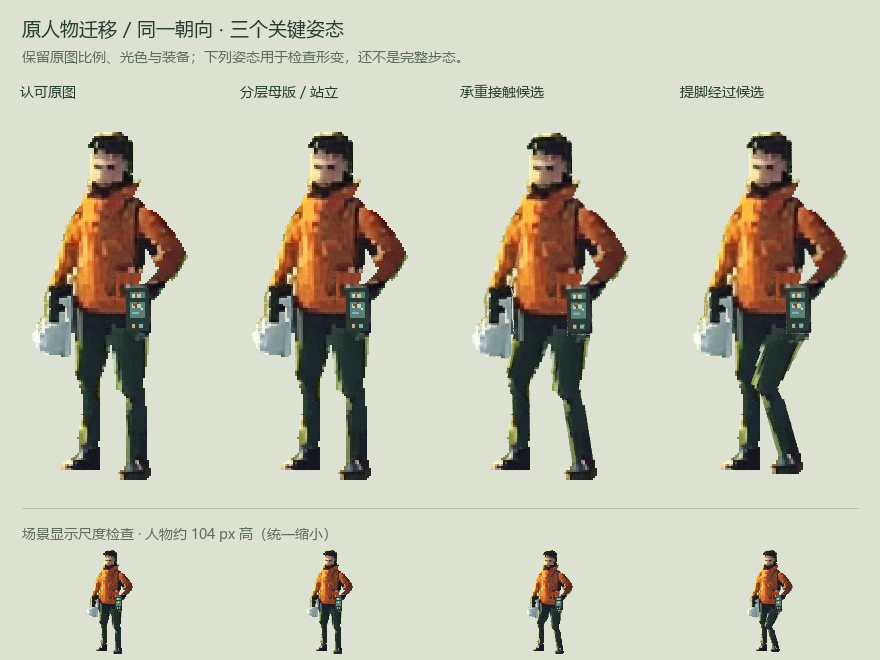

# 原人物迁移：分层母版与三张关键姿态

**后续更新：** 已制作 [v02 姿态修订并总结制作管线](homepage-character-editable-pipeline.md)，接通独立姿态修绘和底图失效保护。本文保留 v01 的输入、工程与画面判断供对照。

2026-10-28：接续 [COA 完整工程复现](homepage-cutout-pipeline-reproduction.md)，已将本站认可的 `actor-front.png` 接入同类二维分层／网格／骨骼制作流程，产出站立、承重接触和提脚经过三张姿态。新骨架按本站人物设置，没有沿用示例兽人的造型或动作。



## 这次具体做了什么

- 使用原图 156 × 348 的实际像素，不另换脸、不缩头，也没有使用旧视频、standing02 或程序人物作为身体来源。
- 建立 9 个绘画层与 18 根骨骼。头、颈、外套保留在一张连续网格内，头部随躯干运动；两条腿连同原鞋分别蒙皮。右手银箱、左手绿记录器分别归属对应手骨，未镜像换手。
- 肩部遮挡内的小幅袖片补区由相邻袖料取色填充；裤腰下有被原画遮住的重叠区。它们只支持当前小幅形变，不能代表另一朝向或完整隐藏肢体已经补绘。
- 保存分层 OpenRaster、包含打包纹理和动作的 Blender 工程、原图坐标下的骨架／姿态规格与三张 RGBA 输出。帧 1／9／17 分别对应三个姿态。

原图、原始站姿合成和姿态输出在上图按同一相机、同一尺度比较。下面约 104px 的缩小显示只检查场景可辨度，不将它称为原图的原生像素尺寸。

## 当前画面判断

脸型、头颈比例、外套与两手装备仍来自同一张认可原图，小幅形变没有出现之前的头部错位和关节断缝。检查时曾发现接近伸直的支撑腿被 IK 切换到另一解，产生无谓屈膝；现保留支撑腿原配置，仅求解需要改变的腿。

**仍未通过完整步态美术：**提脚姿态的近侧膝部衣褶被网格拉成斜纹，髋部到裤腿的折转也偏硬。器物仍主要保留原画握持，负重时肩、肘、箱体的反应尚未单独验收。三个关键姿态不等于自然的行走循环，也尚未测试转身、另一视角、世界地面接触或路径移动。

下一步先校正这些关键姿态的裤料体积和褶皱，把需要逐帧修绘的位置与可共用的母版部分分开；通过后再补另一脚的关键姿态与停步。当前不扩大为几十帧，也不接正式首页。

## 可回改的文件与操作

- [分层画稿 ORA](../prototypes/visual-direction/actor-rig-media/actor-v01-layers.ora)：可以在支持 OpenRaster 的绘画软件中编辑。保持九层名称、顺序、原画尺寸、普通混合及完整图层不透明度；局部像素透明度可以保留。
- [骨架与姿态工程](../prototypes/visual-direction/actor-rig-media/actor-v01-editable.blend)：纹理已打包，骨架、蒙皮、关键姿态可继续修改；不依赖 COA 插件。
- [骨架、拆层与姿态规格](../prototypes/visual-direction/actor-rig-media/actor-rig-v01.spec.json)：坐标使用原图左上角为原点的像素坐标。
- [两倍像素对照](../prototypes/visual-direction/actor-rig-media/actor-v01-detail.png)／[拆层概览](../prototypes/visual-direction/actor-rig-media/actor-v01-layers-review.png)／[三姿态切换](../prototypes/visual-direction/actor-rig-media/actor-v01-pose-switch.webp)。切换预览用于检查姿态差异，不表示走路。

从原图重建并检查：

```powershell
E:/DevCache/tools/unmapped-sprite-bpy/Scripts/python.exe scripts/build-actor-cutout.py
E:/DevCache/tools/unmapped-sprite-bpy/Scripts/python.exe scripts/check-actor-cutout.py
```

补绘画稿后，可以重新导入同一骨架，输出到独立目录；脚本拒绝覆盖原稿目录或导入的 ORA：

```powershell
E:/DevCache/tools/unmapped-sprite-bpy/Scripts/python.exe scripts/build-actor-cutout.py --layers-ora path/to/edited.ora --out-dir .lab/actor-layer-study/edited-export
E:/DevCache/tools/unmapped-sprite-bpy/Scripts/python.exe scripts/check-actor-cutout.py --out-dir .lab/actor-layer-study/edited-export
```

回导支持绘画软件常用的图层裁切与 x/y 偏移，不独立缩放身体部件。母版层的修改影响所有姿态；仅某个弯膝姿态需要的褶皱，应保留为该姿态的修绘，不直接画回其他姿态共用的腿层。

## 实际验证范围

分层原始站姿的 RGBA 合成与原图逐像素一致。Blender 原站姿输出轮廓透明度一致，只有一处纹理三角形边界像素存在最大 4/255 的颜色差异。关闭渲染抖色，避免无关的逐像素颜色噪声。

重新打开保存的 `.blend` 后，三个姿态重渲染都与首次输出的 RGBA 一致。将未改动的 ORA 回导，三个姿态输出也保持一致；另在隔离副本中改动一个衣料像素，实际导出验证该修改随蒙皮进入三个姿态。该测试修改留在 `.lab`，没有进入交付美术。

详见[结果与来源](../prototypes/visual-direction/actor-rig-media/actor-v01.json)及[验证记录](../prototypes/visual-direction/actor-rig-media/actor-v01-validation.json)。这些检查支持可回改、可保存和可导出的结论，不替代上述美术问题的判断。本轮没有图片或视频生成调用，没有修改正式首页。
