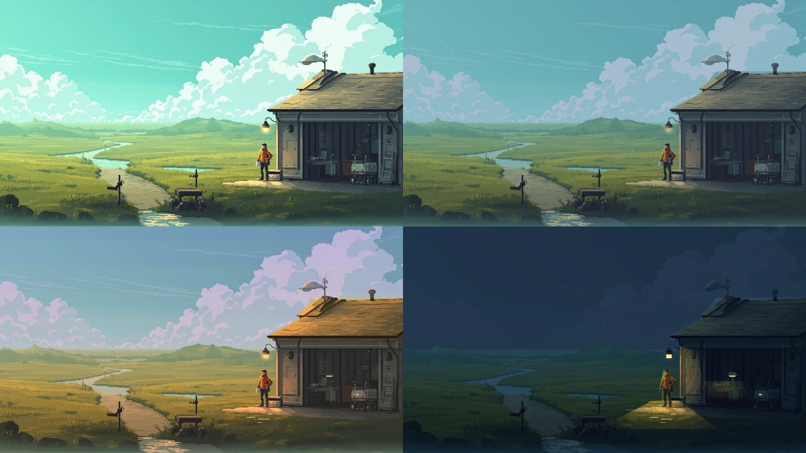
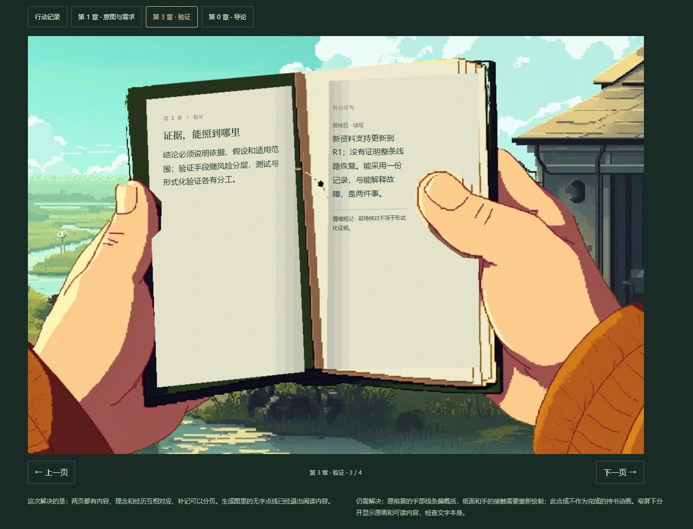

# 第一阶段美术预览 · 2026-10-28

用户批准按“关键美术 → 三段完整脚本 → 第一段可玩样片”推进。本轮落实第一阶段的独立预览，**尚未通过美术定稿标准**。没有接入正式首页，也没有将旧站姿平移重新当作行走。

**继续制作：** 已发现并修正旧朝向参照的标注问题，改用原片精确帧号生成朝左侧面、朝左背侧与背面。详见[动作小样规格与纠正记录](./homepage-motion-proof.md)。此后新增生成调用为零，固定方向步态仍未通过。

**视频能力复查：** 当前 OAuth 登录的 MMX 文本配额面板显示视频“不在当前套餐中”，并非已有可用额度。继续制作这一轮未再创建请求，等待可用的视频凭据或用户选定逐帧绘制路线；不静默切换付费凭据，也不将显示的“100%”解释成可以提交。

实际预览：[同一路上 · 美术包 01](http://127.0.0.1:4395/art-pack.html)。[页面源码](../prototypes/visual-direction/art-pack.html)、[离线制作脚本](../prototypes/visual-direction/build-art-pack.mjs)与[完整来源清单](../prototypes/visual-direction/art-pack-media/sources.json)均已保存。

## 当前能检查的结果

| 项目 | 实际交付 | 验收状态 |
| --- | --- | --- |
| 人与四轮载体 | 原画人物与既有视频的正、侧、后侧、背面参照；原画载体透明剪影 | 身份基准可对照；负重步态、停步、持书及端口操作的新姿态缺失 |
| 真实内容手记 | 接委托、带回资料、坡肩续写三种累积快照；行动、意图、验证、导论四组短记；页组与补记分页 | 内容和分页已核验；手部画法、封皮改成双纸页的结构、持握角度仍待重绘 |
| 工位与 R1 | 原画工位取景；同场所像素柜体、雨罩、端口、线缆与原画载体的结构试排；小屏实际来源／状态文字 | 仅结构及取景研究；柜体材质、脚点、接线端点与完整接入姿态未通过 |
| 水道与坡肩 | 既有远景候选的草地色温修订 | 来路、遮挡、视野展开的连续新机位缺失；失败的前景拼接已撤下 |
| 同地点光色 | 雨后原画、低云／雨丝、傍晚、夜间四张同坐标对照；夜稿分别处理檐灯、工位灯和近地照明 | 仅光色研究；低云云形、低角度投影、夜间光斑和接触阴影未完成 |

四张图保持站房、道路、溪流与设备的原画坐标。离线按连通的天空像素分区，避免用一条水平线切开天空和地表；屋顶与局部照明另行处理。夜稿增加实体工位灯，原檐灯在墙面、近地和人物附近有对应受光研究。原画日照投影尚未重新绘制，所以不能将它称为完成的全天气／昼夜美术。

手记不使用本轮摄影质感的生成图。它沿用上一轮像素前景，保留双手位置与拇指接触，重绘两页留白并局部调整袖口色温；文字避开书脊与拇指。左页是理念、对象与图例，右页按事件追加短记，全部文字来自 `story-notebook.mjs` 的情境转述，不伪装原文引述。小屏把图与文字分开，便于检查内容，尚不是正式手机手记的美术方案。

## 本轮生成取舍

本轮 MMX image-01 共 **4 次图片调用、每次 1 张**，均为 1920×1080；与上一轮关键帧研究的四次调用分开计数。本轮四张均未作为通过的美术使用。

| 资产 | 种子 | 决定 |
| --- | --- | --- |
| 持书 v03 | 281101 | 摄影式手部与书本，拒用；没有缩小像素化后冒充像素画 |
| R1 v01 | 281102 | 载体偏重、画法偏平滑并增加远处塔体，拒用于连续场景 |
| 坡肩 v03 | 281103 | 偏三维渲染，路径、地形与设备尺度漂移，拒用 |
| 角色表 v03 | 281104 | 服装与装备漂移，姿态数量不符、画风偏平滑，拒作角色与动作来源 |

前三次使用认可原画作为接口的 `type=character` 参照，角色表使用既有正面人物帧。**人物参照参数无法保证锁住像素风格或场景构图。** 原始 JPEG、实际提示词、种子、参考与 SHA-256 都保留在来源清单；网页默认不载入这些拒用图。

视频仅尝试创建一次固定侧向负重步态，输入为此前侧面站姿帧，模型 MiniMax-Hailuo-2.3。接口返回 Token Plan 用量上限，**没有任务 ID、没有生成视频、没有重试或更换付费凭据**。旧转身视频仍只用于朝向参考，不能当作此次通过的往返动作。

本轮失败的右手平移和坡肩前景拼接已经撤回。未采用的派生图已移除，原始四张生成结果保留。不会以请求完成或网页测试通过代替美术验收。

## 已做的实现检查

- 检查三份内容快照中所有可见页组和全部补记：顺序不丢失、不重复，首尾按钮状态正确，切换理念后焦点到标题；重复渲染不改变内容。
- 检查桌面纸面文字与来源说明的边界、390px 窄屏横向边界；小屏使用独立可读文字而不是缩小整张书页。
- 连续快速切换环境后，图像和图注均保留最后一次选择；切换前解码，失败分支保留当前图像。R1 切图按自身比例呈现，已移除固定比例造成的大块留白。
- 六张截图使用统一 `scripts/shot.mjs --batch` 入口，分两批完成；两次均按自有 Chrome PID 树清理，残留进程 0。
- 页面没有自动播放、绘制循环或运行时依赖，不读写探索存档。图片给出尺寸，后续图片延迟加载，首图提升优先级。

节点语法检查、来源路径与哈希校验、`git diff --check` 均通过。正式站点和章节源文未变更，因此本轮没有重建或发布生产站点。十分钟持续运行、移动接管、现场恢复、旧存档迁移等属于可玩样片验收，**尚未实施**。

## 后续仍按原顺序推进

1. 第一阶段继续：统一自然持握与双页结构；制作可信的转身／往返负重小样；补齐 R1 完整美术与“接近—遮挡—展开”连续机位，再精修光源投影。当前美术关卡未通过，不能批量扩展资产。
2. 通过上述检查后，展开三段全部逐镜脚本，每镜补全场所、可见物、操作、后果、记录新增，以及失败／取消／返回／重试。目前第一段文本排演不等于三段定稿。
3. 再做限定通路内的主动移动，随后接同状态的可取消自动行进、载体执行与工位交接；统一位置、证据、任务、环境、追加短记和书签持久化。旧试作不迁为新剧情证据，章节原文保持开放。

环境仍按既定故事事件推进。第一段短途保持同一雨后午后；傍晚与夜间对照服务后两段，不能靠阅读时间、后台计时或操作几下让天气跳变。雪景仍留在冷季或高地支线。
