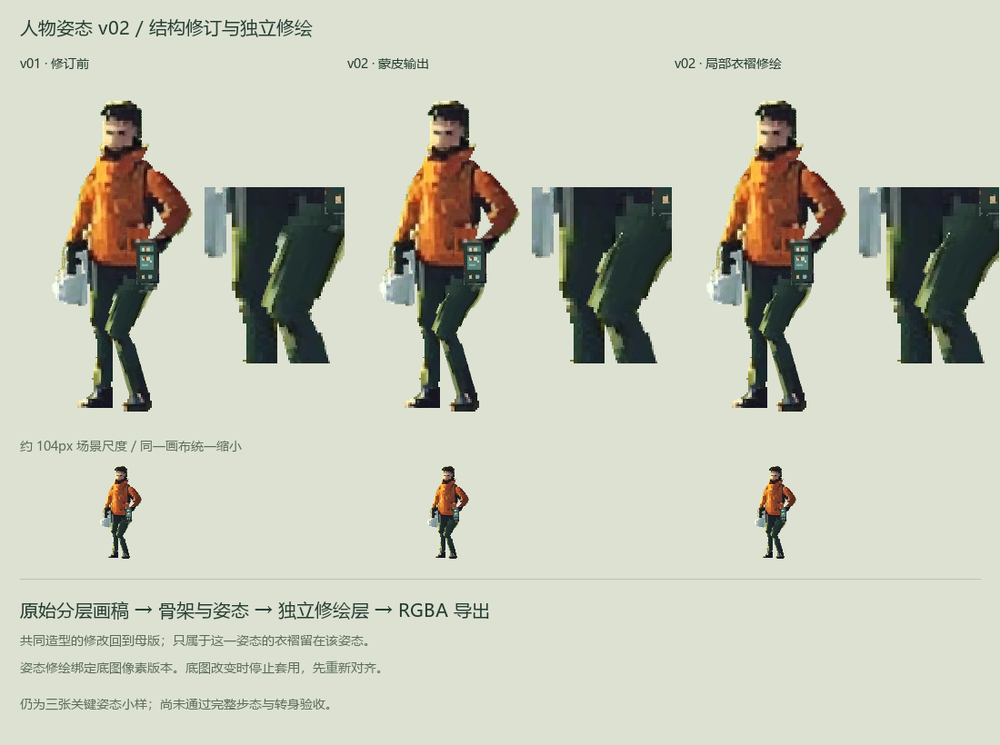

# 人物制作管线总结与 v02 姿态修订

**后续动作小样：** 已补出 [v03 负重换步与停步短片](homepage-character-load-motion.md)，检查了支撑脚、手箱握点与停步像素稳定；完整动画美术仍待验收。本文保留 v02 的独立修绘闭环与制作经验。

2026-10-28。当前已实测的制作链为：**原图分层画稿 → 可编辑骨架与关键姿态 → 基础 RGBA 帧 → 独立姿态修绘 → 最终 RGBA 帧。** 共用衣装可回到母版修改，单个弯膝的衣褶留在该姿态；重新导出时检查两者的对应关系。



## 本轮推进结果

后续制作：[v03 负重短步](homepage-character-load-motion.md) 已推进至 [v04 逐帧修绘对照](homepage-character-motion-retouch.md)。以下为 v02 共享母版与姿态修绘闭环记录。

沿用原人物和原三个姿态，未增加方向或长循环。v02 调整裤腰与腿的权重过渡，并对腿部采用保持体积的蒙皮；头颈、上衣和装备的上半身画面保持原输出。初次让整块裤腰过早随腿转动，曾在记录器下露出缺口，该参数组合已淘汰。延后过渡后，髋部到大腿的接合较连贯。

提脚姿态另外制作了两层局部膝部色块／压缩褶皱，保存在独立 ORA。第一版褶皱过于像横带，未选用；当前版收为有限的小色块修订，没有改轮廓或把它画回所有姿态共用的腿层。这是程序辅助的局部像素修绘，不是完整人物重绘。

**画面仍有局限：**裤料的转折仍偏概括，当前人物只验证同一视角的三个关键姿态。动态像素稳定、完整两步、停步、转身、负重响应与场景接触尚未验收。当前选用表示本轮候选选择，`artApproved` 仍为 false；正式首页未更新。本轮没有图片或视频生成调用。

## 已验证的管线经验

| 环节 | 本次实际经验 | 后续做法 |
| --- | --- | --- |
| 方法选择 | 有完整素材、骨架和动作的 COA 工程，能实际改姿态并重开导出 | 用完整制作片段判断可行性；缺源资产的仓库只作为方法资料 |
| 人物迁移 | 从同一张认可原图出发，原站姿分层合成可保持一致 | 保留身份和比例，共同检查母版与少量姿态；不再混合不同视频帧的人体 |
| 分层与蒙皮 | 连续颈肩网格减少硬接缝；裤腰权重调整仍受隐藏素材覆盖限制 | 先检查遮挡、覆盖与权重，再画衣褶；保留体积模式需要实际比较 |
| 可回改性 | 未改 ORA 回导结果一致；隔离副本中的衣料修改能进入多个姿态 | 用一次真实修改贯穿输入到导出，不能只以“有工程文件”判断完成 |
| 姿态修绘 | 弯膝褶皱属于该姿态，独立 ORA 能继续修改并导出 | 共用造型回母版；姿态专用内容留在对应基础帧之后 |
| 版本关系 | 改变基础帧后，旧修绘会被拒绝套用，已有结果不被覆盖 | 记录基础帧 RGBA 摘要、画布与修绘源；先验依赖再写输出 |
| 验收 | 保存重开、原图一致、闭环检查均不能证明自然步态 | 分开记录工程、美术、完整动作与场景行为 |

此前反复调整的主要原因，是在人物输入不统一、制作源不能持续回改时就扩大了动作量，随后依靠局部比例和纹理补丁追着问题修。现在能把修改放回明确的来源，判断它影响共享母版、绑定还是某个姿态，也能保留修改前的可比较结果。

当前可复用的路线是**二维绑定提供一致形体与动作基础，再用有限的姿态修绘处理衣褶和像素组织**。这条路线已验证制作闭环，本站完整动画仍需继续验证。其他方向缺少的衣装、手、鞋和遮挡内容需要真实制作，当前正面分层不会自动补齐。

## 当前使用的文件

- [v02 骨架工程](../prototypes/visual-direction/actor-rig-v02/actor-v02-editable.blend)／[共享分层画稿](../prototypes/visual-direction/actor-rig-v02/actor-v02-layers.ora)／[骨架与姿态规格](../prototypes/visual-direction/actor-rig-v02/actor-rig-v02.spec.json)。
- [当前选用的膝部修绘 ORA](../prototypes/visual-direction/actor-rig-v02/pose-corrections-v02b/passing.ora)：底层 `base_render` 保留不动，编辑 `knee_surface` 和 `compression_folds`。
- [最终提脚姿态](../prototypes/visual-direction/actor-rig-v02/final-v02b/actor-v02-passing.png)／[最终导出记录](../prototypes/visual-direction/actor-rig-v02/final-v02b/actor-v02-finish.json)。站立与接触无需额外修绘，沿用 v02 蒙皮输出。
- [工程重开验证](../prototypes/visual-direction/actor-rig-v02/actor-v02-validation.json)／[回导与失效保护验证](../prototypes/visual-direction/actor-rig-v02/actor-v02-pipeline-validation.json)。
- [真实修绘与裁切图层回导验证](../prototypes/visual-direction/actor-rig-v02/actor-v02-finish-validation.json)：在隔离副本中实际编辑修绘层，确认只改变对应姿态；底图和归档底图被改动时均拒绝导出。

`pose-corrections-v02`／`final-v02` 是未选用的第一版局部修绘；当前配方与交付记录明确指向 `pose-corrections-v02b`／`final-v02b`。v01 文件保留供对照。

## 重建与继续补绘

在仓库根目录，使用已有的 Blender Python 环境。以下命令只重建基础帧并验证工程；新底图与旧修绘不匹配时，最后的合成会停止：

```powershell
E:/DevCache/tools/unmapped-sprite-bpy/Scripts/python.exe scripts/build-actor-cutout.py --spec prototypes/visual-direction/actor-rig-v02/actor-rig-v02.spec.json --out-dir prototypes/visual-direction/actor-rig-v02
E:/DevCache/tools/unmapped-sprite-bpy/Scripts/python.exe scripts/check-actor-cutout.py --out-dir prototypes/visual-direction/actor-rig-v02 --tag actor-v02
E:/DevCache/tools/unmapped-sprite-bpy/Scripts/python.exe scripts/finish-actor-poses.py --recipe prototypes/visual-direction/actor-rig-v02/actor-v02-retouch.recipe.json
E:/DevCache/tools/unmapped-sprite-bpy/Scripts/python.exe scripts/check-actor-finish.py --recipe prototypes/visual-direction/actor-rig-v02/actor-v02-retouch.recipe.json
```

修改共享 ORA 后，通过 `build-actor-cutout.py --layers-ora <画稿> --spec <对应规格> --out-dir <新版本目录>` 回导。姿态补绘则编辑对应 ORA 并重新执行合成命令。初次建立修绘源使用 `--prepare`，该操作拒绝覆盖已有修绘；改变基础姿态时，应建立新版本，重新检查后转移仍然适用的修绘。

下一步在少量关键姿态中检查负重肩肘与箱体响应，再补另一脚和停步。转为连续帧时，姿态专用修绘也要有对应帧或切换安排，不能只补骨架插值。

## 已沉淀到技能的内容

通用经验位于 [unmapped-pixel-art 的制作管线参考](../.agents/skills/unmapped-pixel-art/references/editable-character-pipeline.md)，并由技能入口按需链接。它保留制作片段复现、回改范围、实际回导验证、接缝／IK／蒙皮诊断及修绘失效规则；本站的角色、骨数、尺寸、文件位置和脚本命令只保留在项目文档中。
