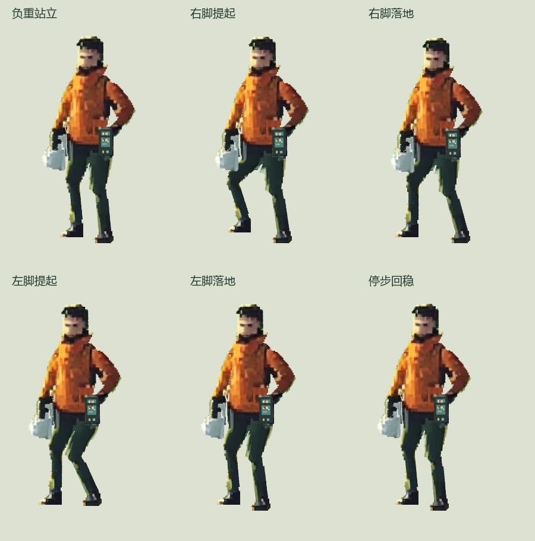

# 负重换步与停步小样 v03

后续进展：已制作 [v04 局部衣褶与逐帧对照](homepage-character-motion-retouch.md)，仍沿用此版本的动作底帧。以下保留 v03 原始交付记录。

2026-10-28：沿用原人物、同一朝向和 v02 分层／绑定方式，补出右脚提起与落地、左脚提起与落地、收重心和停步。已导出约 4.08 秒的本地动作预览，含完整人物、跟随握点的三倍近景和约 104px 场景显示尺度。

[播放动作短片](../prototypes/visual-direction/actor-rig-v03/actor-v03-motion.mp4)／[单次播放的无损 WebP](../prototypes/visual-direction/actor-rig-v03/actor-v03-motion.webp)



## 这次新增的动作依据

- 右侧承重肩小幅下沉，肘部保持有限屈曲。动作由当前姿态参数编排，没有把它宣称为质量或肌肉的物理解算。
- 银箱绕握点摆动，相对世界竖直保持小幅倾角，峰值约 2.5°；停步时衰减回正。左手记录器仍归属原手，没有镜像换手。
- 两次短步包含提脚阶段；支撑脚在相应区间保持同一世界脚点。身体在固定相机下累计向左移 36 个原画像素，随后收重心停住。
- 每个实际导出时刻都重新求解脚点和器物角度，并保存对应骨架姿态。共 49 个预览帧，12fps；第 0 帧另保留原画站姿参考。

## 当前验证结果与局限

保存重开后，重新渲染了原画参考、左右提脚、落地和停步等七个时刻，RGBA 与首次输出一致。所有导出时刻的手箱握点保持连接，支撑脚点最大偏差约 0.000009 个原画像素；支撑区间抽取的鞋底不透明像素没有变化。停步保持段的头部像素一致，头部没有独立缩放。

详见[动作验证记录](../prototypes/visual-direction/actor-rig-v03/actor-v03-motion-validation.json)。这些结果支持当前固定相机下的约束与取样稳定，不代表已经完成自然步态或场景验收。

当前是**同朝向的短步负重候选**。动作幅度偏克制，腿部衣褶仍有拉伸，尚未逐帧精修；转身、连续循环、长距离位移、可变速度与真实场景地面未验收。v02 的姿态修绘没有套到这些不同位置／不同姿态的底图上。正式首页未更新，未发生图片或视频生成调用。

## 可继续编辑的工程

- [骨架与逐帧约束姿态](../prototypes/visual-direction/actor-rig-v03/actor-v03-editable.blend)。
- [源分层画稿](../prototypes/visual-direction/actor-rig-v03/actor-v03-layers.ora)／[动作控制与支撑区间](../prototypes/visual-direction/actor-rig-v03/actor-rig-v03.spec.json)。
- [导出帧与来源](../prototypes/visual-direction/actor-rig-v03/actor-v03.json)／[重开后实际求值点](../prototypes/visual-direction/actor-rig-v03/actor-v03-evaluated-points.json)。

重建与验证：

```powershell
E:/DevCache/tools/unmapped-sprite-bpy/Scripts/python.exe scripts/build-actor-cutout.py --spec prototypes/visual-direction/actor-rig-v03/actor-rig-v03.spec.json --out-dir prototypes/visual-direction/actor-rig-v03
E:/DevCache/tools/unmapped-sprite-bpy/Scripts/python.exe scripts/check-actor-load-motion.py
```

首次比较新动作可给构建命令加 `--keys-only`，先检查少量关键姿态，再导出过渡帧。预览由本机 FFmpeg 合成 MP4；原始 RGBA 帧另行保留，WebP 供无损对照。12fps 指本次离线人物帧率，不是首页页面帧率。

这轮新增的可复用经验是：**约束应在实际导出时刻持续生效；骨架脚点固定后，还要查看鞋底像素和握点。**器物握点随手，悬挂器物的朝向可独立参考重力。后续衣褶修绘要对应具体底图与过渡帧，不能因骨架相似就复用旧补丁。
