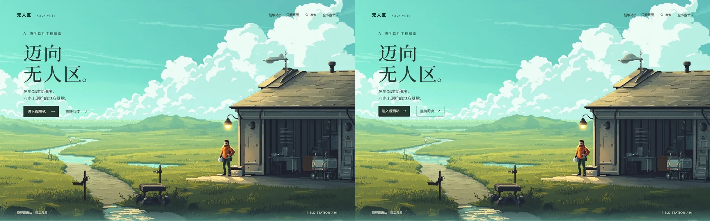
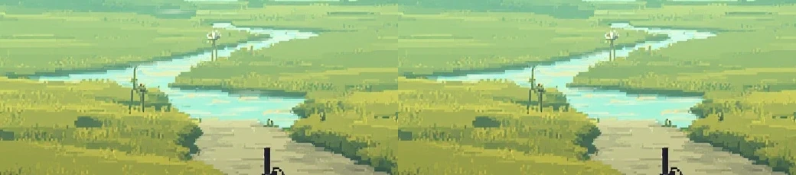

# 首屏控件、水纹与入夜提案 · 2026-10-27

用户指出按钮样式不统一、Tab 焦点框突兀、水面动效难辨，并询问夜景及后续方向。当前修正继续使用已认可的原画和交互，不增加图片或视频生成调用。

## 已修正

入口和场景操作使用同一动作规范：44px 最小高度、1px 边框、3px 圆角、统一行高、内边距和垂直居中；链接与按钮保持原生语义。主操作保留实底，辅助操作使用细边框，与所在明暗表面匹配。桌面两枚入口均为 44px，原本主操作 46px、阅读入口 44px；操作区原先 36px，现在同为 44px。

Tab 焦点保留 2px 轮廓。旧版 currentColor 加 6px 外扩在深色实底按钮上呈现脱离按钮的浅色大框；现在主按钮内收 4px、文字操作外扩 2px，不再添加光晕。系统强制颜色模式使用 Highlight。深绿与浅纸色对比约 10.94:1；没有删除键盘焦点提示。

水面原先仍在绘制，但高光透明度较低，旧测试只比较 WebGL 输出 RGB，无法代表叠在原画上的可见程度。现在反光由成组像素条构成，在原水面遮罩内传播，岸线和原画地形不位移。测试将透明通道与实际底图合成后比较 0／2 秒：水面平均最大通道变化由 2.10／255 提高到 11.71／255，变化超过 5／255 的采样占比由 14.2% 提高到 47.5%。这些是同一视口与取样条件的局部可见度指标，不是审美评分或用户设备帧率。

白天取消额外檐灯明暗与墙面亮度脉冲，保留原画的暖色玻璃。设备屏幕仍有独立采样节奏，屋顶风向设施继续运动。没有声称把烘焙进原画的灯光完全熄灭。

## 验证与对照

构建成功，21 个资源引用有效，10 章正文逐字节一致。`node prototypes/visual-direction/browser-check.mjs --home --with-lifecycle --with-surface` 共 78 项通过，覆盖既有流程、资源生命周期、最终水面合成、静态檐灯、真实键盘焦点、强制颜色与多个视口的操作区边界。单次绘制、3 张纹理和 30fps 默认预算保留。测试自有 Chrome 的进程树与 profile 在 finally 精确清理，残留 0。

截图只使用统一 batch 入口，共 6 张，涵盖入口焦点、场景操作、同一取景 0／2 秒水面、768px 短窗口与手机。首轮水纹截图发现压暗基础颜色形成深边，最终改为只叠加反光，后续用实际 WebGL 合成像素核验，没有追加截图。报告保留本地 `.lab/meadow-production/browser-report.json`，修正前基线保留 `.lab/home-surface/before.json`。按钮截图及最终水纹离线合成如下；按钮与水纹仍需用户观感评审，检查通过不等同于美术验收。

## 下一步提案：同一观测站入夜

目前没有可切换夜景。先制作同一构图的入夜视觉稿，保留建筑、路径、岸线、人物身份和测点位置；认可后再接手动切换。白天仍保留为默认，不强制按访问时间改变场景，也不把阅读页深色主题等同于场景夜间。

- 天空进入冷蓝暮色，地平线保留少量余光，云团、远坡和维护路仍有可辨色阶，不整幅压成灰黑。
- 檐灯稳定照亮工位、台阶、工具与附近地面。暖光服从遮挡与距离，人物背光面保留冷天光；灯本身不无故闪烁。
- 水面接住天空和局部暖光，反光沿水面分段，随风形成连续细波。远处能见度下降应影响观察与下一段路线的判断，而不是加一层全屏雾。
- 机器屏幕与状态灯独立于照明，不把整座建筑做成同步呼吸灯。夜间 UI 使用对应表面与可读文字，不覆盖整片景色。
- 实现时按需加载选定时段的图片与匹配天空，不新增第二套常驻画布或同时保留两套 GPU 纹理；手机和减少动态设置继续有完整静态画面。

后续探索仍需要方向一致的人物转身、行走与到点观察资产。夜景作为环境美术推进，不能替代人物动作或下一片可进入区域的验收。

## 指南应用

本轮采用 modern-web-guidance 的 accessibility 指南中 “Use `:focus-visible` when styling focus indicators” 和 “Prefer `outline` over other properties for focus rings”，保持真正的键盘提示与系统强制颜色。检索了 css、motion 指南，没有为了控件修正引入新的动画框架、路由或绘制层。
