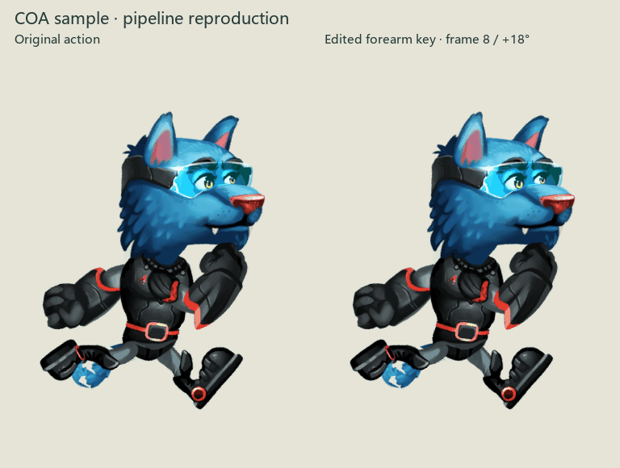

# 二维分层动画：完整工程复现

2026-10-28：已在本机跑通 **原始分层素材 → 已有蒙皮与骨架 → 原动作 → 修改关键姿态 → 保存工程 → 导出帧 → 重开复验**。这证明了一段可编辑、可重复导出的二维制作流程，本站人物的美术与步态尚未通过。



左侧是示例原动作；右侧复制该动作，在第 8 帧将 `Forearm_L` 沿画面内的关节轴增加 18°。两版使用同一固定镜头。修改影响相邻插值帧，首尾姿态保持一致。

## 实际采用的源工程

[COA Tools](https://github.com/ndee85/coa_tools)，固定提交 `167e0b2fd75f51a1a3b2284044b210ac886be208`，`Sample Files/stip.blend`。它带有 22 张 PNG 部件、布局 JSON、网格、UV、权重、23 根骨骼和 Idle／Run 动作。此次导出原 Run 的 0–19 帧，共 20 帧。

源文件来自 Blender 2.79。本机使用 `bpy 4.5.3`，将旧 Blender Internal 材质转为读取原纹理透明度的无光照材质，打包 22 张使用中的纹理，再以固定相机输出 384 × 512 RGBA 帧。人物部件、网格、UV、权重和骨架来自原工程。打开时关闭嵌入脚本；没有安装或运行旧版 COA 插件。

这是第三方蓝色兽人角色的技术例子，不用作本站角色。上游仓库提供 GPL-3.0，交付目录保留[来源说明](../prototypes/visual-direction/cutout-pipeline-media/ATTRIBUTION.md)与许可证；未将美术单独认定为 CC0 或其他无限制素材。

## 已验证到哪一步

- 两版均导出 20 帧；修改实际改变第 8 帧，帧尺寸和镜头一致。
- 分别重开两个已保存工程，再渲染第 0、8 帧；RGBA 像素与各自首次导出完全一致。
- 重开后仍保留 23 根骨骼及 22 张已打包的使用中纹理。
- 修改轴按骨骼静止空间转换，形成画面内的前臂弯曲，避免绕错误轴造成侧翻。

完整记录见[验证 JSON](research/homepage-cutout-reproduction-validation.json)。保存与修改通过 Blender 数据 API 完成，尚未验证 GUI 编辑操作，也没有逐项核对旧 COA 运行时的动态槽位、层序等插件行为。此次不据此宣称本站人物的像素风格、负重、脚底接触或转身已成立。

## 复现与交付文件

在仓库根目录运行，所用 Python 环境需含 `bpy 4.5.3` 和 Pillow：

```powershell
E:/DevCache/tools/unmapped-sprite-bpy/Scripts/python.exe scripts/run-cutout-reproduction.py
```

[协调脚本](../scripts/run-cutout-reproduction.py)按[源文件清单](research/homepage-cutout-reproduction-sources.json)校验／下载固定版本的素材，依次调用[工程转换与动作导出](../scripts/reproduce-cutout-pipeline.py)、[重开复验](../scripts/check-cutout-reproduction.py)，最后生成对照、图集与打包工程。不要求新服务账户，本次没有付费媒体生成调用。

- [原动作可编辑工程](../prototypes/visual-direction/cutout-pipeline-media/base-editable.blend)／[修改后可编辑工程](../prototypes/visual-direction/cutout-pipeline-media/edited-editable.blend)
- [第 8 帧静态对照](../prototypes/visual-direction/cutout-pipeline-media/pose-edit-comparison.png)
- [原动作 RGBA 图集](../prototypes/visual-direction/cutout-pipeline-media/base-rgba-spritesheet.png)／[修改后 RGBA 图集](../prototypes/visual-direction/cutout-pipeline-media/edited-rgba-spritesheet.png)
- [动画 WebP](../prototypes/visual-direction/cutout-pipeline-media/cutout-reproduction.webp)／[结果索引](../prototypes/visual-direction/cutout-pipeline-media/result.json)

GIF 使用共享色板供预览；导出帧与 RGBA 图集保留完整颜色及透明度。

## 迁移到本站人物的下一步

目前不再缺一个能运行的绑定软件示例。下一项关键验证是把已认可人物做成能承受动作的分层母版：补齐关节遮挡下的衣料、手臂和裤腿，分开头颈、躯干与器物，保留右手银箱、左手绿记录器及原画比例。单张原画切块后旋转，仍可能出现此前的断颈、裂缝和错误握持。

先保持原图同一朝向，在这一可回改工程内共同检查站立、承重接触与经过姿态；检查头颈肩连接、衣料体积、手部握点和目标显示尺度，再导出少量帧。若像素簇因形变受损，就在导出的关键帧上精修并保留修订源层。另一个真实朝向、转身和完整负重循环须分别验证，不能镜像交换装备。

因此本次结论是：**二维分层绑定已有可复现的制作基础，值得进入本站人物的小规模迁移验证；它尚未替代人物分层补绘和逐帧美术判断。**
