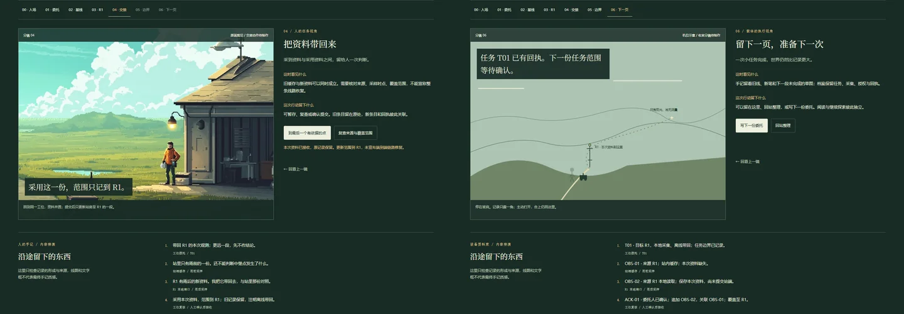

# 雨后的第一份回传

2026-10-28 · 流程、剧情与逐镜脚本 v1 · 设计提案，尚未作为正式玩法上线。

用户认可原野观测站的美术方向，但否定了当前手记质感，并要求先设计流程、剧情和脚本。本稿据此重新组织体验。新增的中继点、离线回传与边界事件属于本轮创作，不能倒写成用户已经确认的设定。

可走读的[脚本排演](http://127.0.0.1:4395/story-rehearsal.html)对应本稿的第一段。排演用原画裁切和明确标识的机位示意检查信息顺序，不充当完成的场景或手记美术。

**2026-10-28 内容与环境补充：** 用户明确手记应随探索积累各章关键理念，而不是只有一页点线；深入未知时气候、环境、时间也需变化。具体[理念页与环境推进](./homepage-notebook-and-world-progression.md)覆盖下文仅强调任务草图的旧表述。第一段排演已有四组可翻阅内容，后两段理念、低云／阵雨、傍晚／夜景仍是待制作规划；短途第一段保持同一午后，不强塞完整昼夜。

## 体验要成立的事情

你在风雨刚过的观测站接手一次短任务：**带回中继点的本次观测，弄清楚地图可以更新到哪里。** 草原仍然明亮，线路仍看得见，站端却只保留了雨前的旧回传。这里没有消失的前任、神秘留言或拯救整片荒原的任务。

先看见具体活动，再意识到其中的工程关系。新资料确实改变站内记录，能明确指出改变的范围；抬头时，前方仍比已确认的部分大得多。完成感来自带回一段可靠资料，继续的欲望来自资料之外仍存在的路。

当前“旧桩在路左／路右”的差异撤出新脚本：左右依赖观察方向，不能据此断定迁移。只有“缺少日期”的旧记录也不宜人为制造谜团。改用两个可同时成立的事实：**站内缓存较旧，中继点本地记录较新**。取回之后依然不能替更远区域背书。

目标时长约 6–8 分钟，自主观察和阅读另计。没有强制倒计时、长按蓄能、章节答题或阅读完成判定。

## 整体故事：先带回，再改动，最后交接

第一段是可以独立结束的体验。后两段给出连贯走向，先不承诺完整制作时长；不把地图切成十个对应章节的景点。

| 段落 | 具体冲突 | 玩家真正改变什么 | 收束与下一步 |
| --- | --- | --- | --- |
| 一 · 雨后的第一份回传 | 站内旧缓存与 R1 本地新记录不一致 | 带回一份有来源的新资料，更新范围到 R1 | 在坡肩看见更远的反光；下一份委托先定位 |
| 二 · 两处装置，一个名字 | 定位远处装置后，发现两处设备使用同一资料标识，新回传会挤掉另一处的记录 | 核对铭牌、位置与维护痕迹，为新增测点提出独立身份和旧档映射；先试运行，再采用 | 新旧记录能够并存，第二处测点第一次在图上有了自己的位置 |
| 三 · 留给下一班 | 线路已有可用的一段，但不能凭一次通过保证往后都对 | 约定重复核对的范围、异常保留和何时返回请求人的判断，将一段日常工作交给载体 | 人收起工作簿，工位空下来；载体仍在已授权范围内工作，远处继续未知 |

第二段不靠一句“标识冲突”直接公布答案：先在工位看到两条回传互相替换，再走到两个现场核对实体铭牌与位置，最后在旧维护标签中找到沿用旧配置的证据。人选定改动边界，载体准备配置与对应关系；用户可以退回修订。试运行至少验证来源能区分、旧记录仍能追溯、撤回后恢复旧映射，再产生正式采用的回执。这里才有真实的设计、实现与测试经历，不用第一段的资料读取冒充这些环节。

第三段的夜景来自回站交接的时间与活动：近景是稳定照亮工位的灯，远处是载体在已确认路线上的采样节奏。人的离开通过收簿、整理工具、让出工位表达；不能只隐藏人物贴图。载体遇到范围外的异常只保留并请求确认，不悄悄扩展任务。结尾不显示“无人区已征服”，只让玩家看到自己留下的一小段秩序确实仍在运转。

情绪从雨后的清澈与好奇，经过一次需要仔细核对的小阻碍，转为傍晚交接后的安静。没有反派和灾难倒计时。空间逐步展开，工作结果逐步累积，手记也从一张任务草图变成带有修订、来源和下一次问题的物件。

## 人与巡检载体：同一事件，两种责任

| 环节 | 人的参与 | 巡检载体的参与 | 留下的东西 |
| --- | --- | --- | --- |
| 接手任务 | 确认要带回哪段资料、哪些判断尚不在任务内 | 读取本次任务范围与回传方式，保留任务版本 | 委托页／任务条目 |
| 检查站端 | 对照记录的来源与时间，确定要核对什么 | 读取缓存状态，输出来源、采样时间、接收状态 | 基线记录 |
| 抵达中继点 | 观察设备与环境，连接记录器读取本地存储 | 停靠本地端口，采集本次记录和接口返回值 | 可追溯的新资料 |
| 回到工位 | 判断是否把本次资料纳入地图，确认适用范围 | 追加资料、标记与旧条目的关系，等待授权提交 | 修订痕迹／追加条目与回执 |
| 面向下一段 | 决定下一次要问什么，不把看见等同于确认 | 报告任务边界外没有本次采样，不自行扩大任务 | 待查草图／下一份任务草案 |

人的动作是携带、观察、连接与裁决；巡检载体是低矮的四轮工具，动作是停靠、扫描、采集与回传。两者共用现场和证据，但不能通过换一个弹窗颜色来宣称模式完成。主角外套、装备和载体轮数延续已认可身份。

正式入口允许选择从人的任务视角或载体的执行视角进入；切换发生在站内交接处，共享已获证据，不把角色瞬移到另一个角色的位置。载体侧遇到范围变更时返回人的确认，默认保留待确认状态。排演里的视角按钮只便于比较两份脚本，不是成品切换动画。

## 第一段：七个节拍

### 00 · 风从屋顶经过

**画面。** 沿用认可首屏：天大、站房偏右、维护路通向水弯。风向设施、云草、水纹彼此呼应。暖色檐灯在日间保持玻璃与材质的静态受光，设备采样灯有功能节奏。

**进入。** 点击进入，书名退开。镜头沿同一空间关系靠近工位，不先弹任务面板。人物收起站姿、望向记录器的动作要由正式资产完成；资产未就绪时排演只标机位。

**信息。** 进入前不讲故障史。进入后给一句：“雨停了。站内的回传还停在雨前。”

**退出。** 随时回首屏或直接阅读，不丢已留记录。

### 01 · 一份小委托

**画面。** 檐下工位近景：记录器、接口、路线小图；工具和手有明确接触。站房依然在原来的一侧。

**人的脚本。** 翻开一页折过角的工作簿。已有一条简图从站房连到 R1，R1 后的线没有画完。正文只有：“带回 R1 的本次观测；更远一段，先不作结论。”玩家选择“接下这段”，在目标下添一笔。

**载体脚本。** 固定终端显示短任务：目标 R1、本次采集、离线带回、范围到 R1。玩家确认执行；不能给载体任意超范围按钮。

**变化。** 得到当前委托和任务边界。手记写下行动记录，同时出现“意图与需求”的首条理念：目标、边界与完成依据应可共同理解、核对。后续向同一页组续写，不在这里铺开整章正文。

### 02 · 工位上留下基线

**画面。** 同一近景，重心由工作簿移到记录器的旧条目。可先检查接口，也可先查回传，两种顺序都收敛到相同事实。

**可见证据。** 缓存来自 R1，采样在降雨前；站端尚未收到本次记录。采样时间与导入时间分开，不用当前电脑时间伪造故事事件。

**人的反馈。** 在目标下记：“站里只有雨前的一份。去 R1 看看。”暂时不写“中继损坏”。

**载体反馈。** 追加缓存基线，状态为“本次资料缺失”，不把旧样本重复标为新回传。

**变化。** 路线出现一个明确目的：取回本次资料。查看一次即可，不要求点击齐所有器物。

### 03 · 沿维护路，走到 R1

**画面。** 离开檐下时，前景器材遮过下肢；经过路弯时，站房逐渐被草坡遮住。保留可回望的地标，不能用整幅图片平移冒充角色在走。行动与朝向、负重、脚点相符。

**R1 近景。** 地面潮湿、设备有使用痕迹。先看装置，再连接本地端口。灯亮只说明设备有状态，不能靠“绿色”直接宣布资料可信。屋顶、草和水的风向持续一致。

**发现。** 端口返回本次采样记录，来源 R1、本地读取，与站内旧缓存是两份不同条目。现有证据只说明“站内缺少这份”，不能单凭这一点断言通信故障原因。

**人的反馈。** “这边已经有了。站里还没收到。”在简图的 R1 旁添本次资料的小记号。

**载体反馈。** 采集原始条目与来源，得到可带回的离线资料；记录采集方式，不伪造端到端实时联通。

### 04 · 把资料带回来

**画面。** 回程较短；看见同一站房的另一侧、人物与工具的接触。进入檐下才展开复核，避免走路时大窗挡住场景。

**决定。** 旧缓存与本次资料并排只比三件事：来自哪里、何时采样、覆盖到哪里。玩家可先复查来源，或将资料暂存；这两种操作保留当前发现。

**人的提交。** 选择“采用本次资料，范围记到 R1”。旧线淡留，R1 前的一段重新描实；旁边注明“离线带回”。原记录未被擦干净。

**载体提交。** 新增条目并关联旧基线，先等待授权；用户确认“将本次资料纳入这段记录”后才生成提交回执。排演中可暂存后返回确认，没有自动替人授权。

**看得见的后果。** 站内记录器从旧样本切到本次资料，地图只更新到 R1；更远一段不跟着变实线。设备表示“资料已接收”，不表示整条线路已修好。

**失败与撤回。** 来源未能读取则保留“待核对”，可以重新连接；取消提交保留候选资料。成功提交后重复点击不重复追加；之后的修订另建条目。

### 05 · 最后一个有依据的点

**画面。** 再沿已核对路段抵达 R1 附近的坡肩。接近时先由草坡挡住前方；最后几步越过遮挡，画面展开成长地平线和更远的细路。人与载体落在近处一侧，已知设施与下一处不可辨的小反光点分居画面两端。此镜头需要新画面，不能把现有远景放大当成完成。

**节奏。** 到坡肩后停下输入推进，让玩家主动抬头。地平线展开约 1.5–2 秒，留约 3 秒无文字的观看空间；玩家可提前操作，减少动态时直接展示最终机位。没有强制等待。

**人的一句话。** 玩家翻到简图背面后才出现：“路还在。我们带回来的，只到这里。”可圈出下一处疑点，形成下一份委托。

**载体的一条资料。** 本次采集范围到 R1；远处反光点只有视觉线索，没有本次定位与测量。任务结束不触发自动前进。

**未知。** 用遮挡解除、视距、尺度、路线失去可辨细节以及证据范围形成，不要求把明亮原野抹黑或铺满雾。风继续穿过画面，设施声变远；声音作为后续资产，不在排演伪造。

### 06 · 留下一页，准备下一次

**画面。** 停留在坡肩。手记可只露一角，主动打开才进入持书近景；合上立即回到该处。没有庆祝弹窗、星级和整屏章节清单。

**手记。** 行动记录留走过的路线、修订与下一段问题；理念页组留“意图与需求”“验证”“导论”的具体短记，能连续翻看。新证据向已有页组追加有来处的补记，后来也可修订；点线有对象、图例和解释，不能代替理念。一次行动允许涉及多个方法，同一理念允许跨段落续写；阅读不作为关卡动作。

**档案。** 任务、基线、本次采集、授权和回执彼此关联。未解项是一份待确认的任务草案，不是“解锁全部”的按钮。

**结束选择。** “留在这里看看”“回站整理”“写下一份委托”。第一段到此完整收束；没有制作的新区域不摆一个无效的“继续前进”。

## 阅读与章节如何出现

| 经历 | 自然关联的方法 | 触发条件 |
| --- | --- | --- |
| 接下一段有边界的委托 | 意图与需求 | 目标与范围已写入当前记录 |
| 比较旧样本、新资料与适用范围 | 验证 | 资料来源得到核对，并留下本次采用范围 |
| 选择带回方式、接口与资料结构 | 设计与架构 | 后续片段真的出现方案权衡时再关联 |
| 修改设备或处理程序并核验结果 | 实现、测试与质量保障 | 需要实际改动与回查事件，本段不凭阅读冒充实现 |
| 将新资料接入共同记录，继续维护 | 集成与交付、持续演进 | 后续扩展真实提交、回滚与新旧冲突后再关联 |

全书章节继续直接开放。场景发现顺序不等于书籍章序；一个地点可涉及多个方法，同一方法也可在后面再次出现。工具与附录作为可查资源，不硬凑成两个目的地。

## 夜景、气候与后续篇章

雨后默认片段保留。第一段完成后若玩家选择“回站整理”，可以进入同一场所的傍晚片段：檐灯稳定照亮工位、人物与附近地面，机器采样灯独立，水接住局部暖光。先完成同构图照明稿，再接时段选择；不按访问时钟强行入夜，也不让玩家为看夜景等几分钟。

后续先扩展一处真实的中继现场与一次可回查的改动，再考虑更远区域。雨雪风影响能见度、地表与接口使用，不能都做成全屏粒子滤镜。具体天气支线尚未编写；本段不同时承担雨、雪、昼夜和全章节的内容量。

## 落地顺序与验收

1. **本轮交付：** 本脚本、手记与档案美术规格、双视角脚本排演。现有网页手记标为功能试作，审美未通过；生产首页本轮保持原状。
2. **接下来先做：** 工位、R1、坡肩三个关键画面的连续分镜，以及持书近景／设备端口的同尺度物件稿。只用原画作身份与光色参考，先用静帧检查连续性；不批量生成整段视频。
3. **然后实现第一段：** 完成出发、R1 连接、回站交接、坡肩停步的最小动作集；按脚本接入证据与范围。先人的完整路线，再用同一资料契约接载体执行侧。
4. **最后扩展：** 认可同场景入夜稿后加入傍晚整理；之后再写下一段委托。

验收看四件事：拿掉说明能否认出行动；回到工位前后有无具体差别；合上记录是否仍在刚才的地点；坡肩分镜能否让人感到“前方确实存在，而我只知道到这里”。功能通过不能代替这些视觉与叙事判断。

## 中断与状态约定

新游戏保留完整自由阅读，探索从空白的本次任务开始。每次有意义的行动保存阶段、角色地点、证据和当前持有的候选资料；刷新恢复现场，不人为开启新一轮出站。显式“新一次委托”才创建新轮次。原功能试作已有记录需保留为“早期试作记录”，不能静默改写成新剧情证据。

人／载体切换在交接处保存各自地点与职责；已提交资料共享，未交付资料归采集者持有。加载失败、关闭手记、搜索、暂停和离屏不改变任务结论。持书时停角色操作与昂贵环境绘制，返回时恢复原地点和用户暂停选择；设备长资料按需展开。

## 排演交付与检查

独立排演支持七镜推进、两种职责文字对读、读取失败后重连、候选资料暂存、复查范围、授权提交、回看和下一份委托草案。回看保留当前证据，重新排演显式清空本次草稿。它没有持久化、真实采样、人物动画或新场景资产，不改写正式首页的记录。

26 项流程检查覆盖两种脚本的前置证据、读取失败不生成资料、暂存不提交、重复确认不重复追加、边界观察、回站保留、回看与显式重启。浏览器截图准备脚本另核对提交范围、回执数量、视角文本、SVG 的实际可见样式、桌面和 390px 横向边界。首轮可视检查发现 SVG 的 hidden 属性未被正确移除，已用全局属性切换修正并复查；字幕移至示意图上方，露出人物、载体与近处基准的尺度关系。

截图共六张、三个 batch，每批单一自有 Chrome；结束按 PID 树精确清理并移除仓库 profile，残留进程 0。截图和流程检查只核验排演表达与状态逻辑，不代表新手记或动作美术通过。本轮未改 site 生产代码、章节源文及部署，不需要重建正式站点。

排演采用 modern-web-guidance 的 accessibility、html 与 motion 指南：原生 radio、button、details 与可辨认 SVG 描述；只在主动推进后移焦点，角色对读不劫持焦点；无自动播放和计时器，按用户动作推进。具体制作仍按[物件规格](./homepage-record-art-direction.md)先做静帧。
