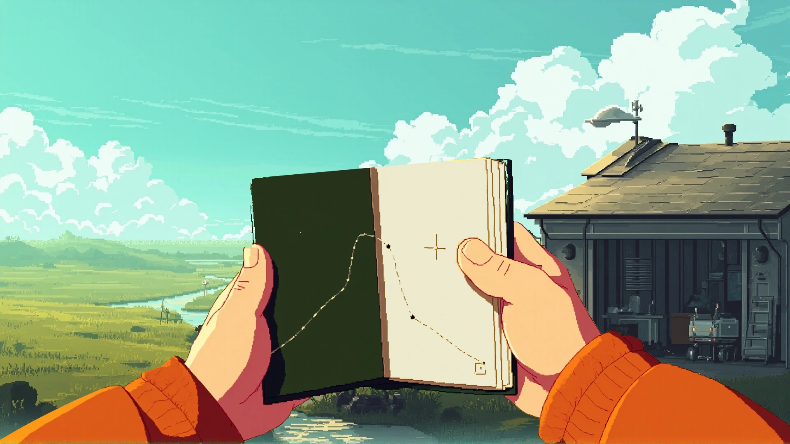
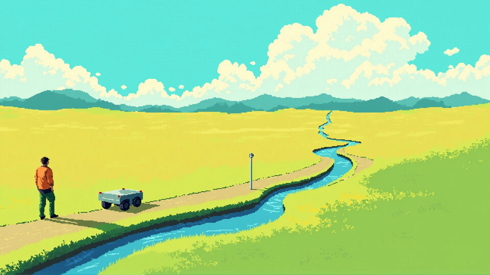

# 从剧本到关键画面 · 2026-10-28

**后续实施状态：** 用户已明确按“美术 → 全流程 → 可玩样片”推进。下一批[美术预览](http://127.0.0.1:4395/art-pack.html)接入真实双页内容、同地点光色与原画身份参照，另有 R1 结构试排；新生成图未通过，连续机位和步态仍缺。详见[第一阶段制作记录](./homepage-art-pack.md)。下文保留上一批四次生成的独立记录，不与新批次的四次调用混算。

用户在脚本排演后要求继续。沿用[七镜脚本](./homepage-exploration-script.md)，本轮先制作持书与边界画面的候选，检查物件和空间，再决定动作资产。不是重新改首屏题材，也不把上一轮手记界面当作已认可设计。

预览：[物件与取景研究](http://127.0.0.1:4395/story-keyframes.html)。原[脚本排演](http://127.0.0.1:4395/story-rehearsal.html)顶部已增加入口。新页面用静态图片和明确批注区分候选、参照与未完成内容，没有替换生产首页。

**后续用户反馈：** 候选研究可继续，但手记不能只有一页意义不明的点线，应随探索写入并续写各章关键理念；深入未知时环境、气候与时间也应变化。[内容与环境推进](./homepage-notebook-and-world-progression.md)已补第一段真实短记、可翻阅页组与后续环境脚本。原生成图不据此成为成品内容排版；后续需按文字面积重做姿态与分页，本补充没有媒体生成。

## 手记：先检查作为物件是否成立

采用薄深绿封皮、布脊、纸叠、双手和赭色袖口，打开的是内封皮和首张草图页。将生成结果中的书与手拆出，重新合成到既有去人物原画，局部把黄纸调整为暖灰白。书页纹理、描线与手部接触仍来自像素绘画，没有把写实稿缩小像素化后当作通过。

相对旧的网页双栏面板，封皮、厚度、接触与所在世界已经进入同一张图中，可以具体检验持有关系。尚未通过的部分也明确：手与袖口比原画更概括且饱和，书的打开角度偏竖、纸页可读面积有限；原场景合成不是新的真实檐下视点。当前画面不承担正文排版，下一步要根据可读区域调整持书姿态，不能把一整章缩进这张小纸页。

## 边界：先检查视距与已知基准

保留背向远处的人、低矮载体、近处观测杆、水道与延伸的维护路。原生成图两处额外车辆和两处伪标记已用局部草地补片清除，处理脚本可复建。

它比第一张近景人物稿更接近宽景目标，但人物仍大于脚本要求，草地偏黄、层次过平，载体造型与原画未完全对齐，缺少越过近处坡肩前的遮挡。可以用来讨论人、基准和远处的面积关系，不能宣布“直面未知”的镜头已经完成。接下来先补连续的接近／遮挡／展开三帧，保留同一地点的来路与设备身份。

## 生成、选择与来源

本轮使用用户此前选定的 MiniMax MMX，image-01 共 4 次，每次 1 张、1920×1080；没有视频调用。

| 次序 | 图稿 | 处理决定 |
| --- | --- | --- |
| 1 | 持书 v01 | 拒用：偏写实、巨大厚册、背景变成高空岛屿 |
| 2 | 边界 v01 | 拒用于连续场景：近景人物过大、大湖与远处高塔均偏离脚本；像素画法作为研究保留 |
| 3 | 持书 v02 | 只选手与簿的前景；背景弃用，局部修色后放回原画作关系检查 |
| 4 | 边界 v02 | 选作宽景候选，清理额外车辆与伪标记，尺度和光色仍待修订 |

前三次采用自有 hero-v04 作为接口的人物参考，第四次仅使用文字约束以检验宽景尺度；该接口不是精确编辑或风格锁定工具。没有上传第三方美术。原图、实际提示词、种子、参考、哈希与派生处理存于[来源记录](../prototypes/visual-direction/story-media/sources.json)。不继续堆生成次数试运气。

派生可通过 `node prototypes/visual-direction/build-story-keyframes.mjs` 离线复建，不发网络请求。两个展示稿约 186KB／202KB，另有各约 53KB／58KB 的 960px 版本；实际字节以文件为准。完整原始 JPEG 与前景 PNG 不随正式首页加载。

## 下一组资产

优先统一书、袖口与原画的像素组织和色温，调整纸页承接真实短句的角度；同时修订边界的近坡遮挡、草地层次与载体身份。接着制作工位收簿、沿路离开、R1 端口采集、回站交接的关键姿态。固定方向与接触姿态未通过前，不生成整段视频，也不恢复旧的错误朝向行走。

用户对物件和镜头候选的视觉反馈会影响后续连续帧。功能排演、静态美术、角色动作和可行走空间分别验收。

## 展示与核验

评审页为静态页面，没有绘制循环或自动切图。图片显式给出宽高和 16:9 比例，首张主图提升加载优先级，其余画面沿页面滚动延迟加载；两张候选提供 960px／1920px 响应式来源。未引入运行时依赖，原始生成结果不被页面引用。

桌面两处画面和 390px 窄屏共三张截图，均通过统一 batch 截图入口；准备脚本核对图片解码、描述与尺寸、横向边界和单一高优先级主图。截图结束按自有 Chrome PID 树精确清理并删除仓库 profile，残留进程 0。来源文件与生成提示词的引用核对有效；未改章节源文，不为独立静态评审页重建正式站点。

应用 modern-web-guidance 的 optimize-image-priority 与 responsive-design：首图不延迟加载，后续普通延迟图片不额外降为低优先级；aspect-ratio 预留空间，字体使用受限的相对字号。样张的审美判断不由这些实现检查代替。
