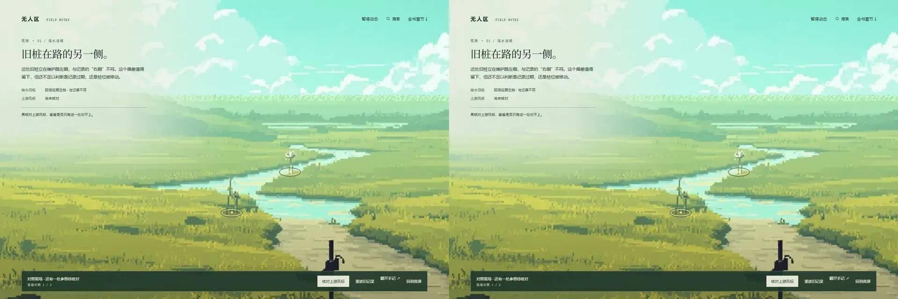

# 观测站加载与资源释放 · 2026-10-27

用户安装并要求使用 modern-web-guidance，随后要求继续。本轮针对首页加载和资源生命周期，沿用已认可原画、镜头与记录内容。

## 复现与修正

通过测试页延迟天空图解码，旧版的观测站入口一并等待；等待中切到手机宽度，解码结束后再回桌面，会保留不完整初始化状态，观测站无法就绪。基线报告中这两项失败，后续等待入口超时，没有浏览器运行异常。这是明确复现的断点竞态，不是对用户此前长期卡顿原因的确认。

现在记录、按钮与镜头先就绪，环境模块和纹理随后加载；手机首次访问继续免加载桌面模块。断点监听在首次异步操作前注册，每次桌面初始化有独立取消信号与实例校验。过期的图像解码等待不会创建 WebGL 上下文或提交纹理，不会把旧实例挂回页面。未强制增加依赖、content-visibility 或永久 will-change。

切到窄屏会停止并销毁桌面实例，删除纹理、程序和缓冲，断开监听，清除镜头内联尺寸与变换，并将绘图缓冲缩到 1×1。返回桌面按需重建，保留本页核对进度及暂停偏好；不会把焦点留在隐藏的操作区，原操作区焦点转至可见阅读入口。WebGL 丢失时仍能查记录，恢复后保留现场视图与发现。销毁可重复调用。

## 验证

`node prototypes/visual-direction/browser-check.mjs --home --with-lifecycle` 共 68 项通过，包括已有环境像素／云向、布局、记录流程、搜索优先级、键盘、压力降档、离屏暂停、手机及无 WebGL 降级，以及新增延迟解码取消、反复跨断点和上下文恢复。

新增测试追踪真实 WebGL create/delete 调用：切到窄屏后纹理、程序、缓冲均为 0；返回桌面后为 3／1／1，连续三轮返回均保留发现。全程纹理峰值 3，没有两套资源重叠。数字代表应用追踪的 GPU 对象，不代表驱动显存计量或整机功耗测量。

构建成功，21 个构建资源引用有效；10 章正文仍与源文件逐字节一致。本轮没有重跑持续负载测试，不重复宣称已解决用户设备上的久开卡顿。此前 3 分钟运行数据见 [持续负载记录](./homepage-scene-revision.md)。

测试报告与基线分别保留在本地 `.lab/meadow-production/browser-report.json`、`.lab/home-lifecycle/before.json`。浏览器使用既有自有 Chrome 入口，在 finally 精确结束进程树并删除 profile，残留进程 0。截图统一走 `scripts/shot.mjs --batch`，新截 1 张并复用上轮验收截图作比较；线上截图尝试未能就绪，退出时已清理且未产图。不是新增美术稿。

两侧取相同原画、视口与镜头，环境相位有所不同。人物、建筑、光色、手记与操作区沿用，差异在异步依赖和资源释放；静帧不能证明取消与释放，相关结论来自行为检查。人物行走及下一片区域仍需独立制作与验收。

## 指南取舍

检查了 `html`、`motion`、`performance` 和 `conditional-async-dependencies`。本轮按 performance 的 “DO use dynamic imports” 保持桌面模块按需加载，并将可用的记录流程从可选环境素材等待中拆开。没有把需要前置完成的依赖任意并行，也没有为了使用新 API 改造首屏绘制架构。取消和销毁逻辑由上述复现测试核验，不将它们冒称指南提供的完整实现。
