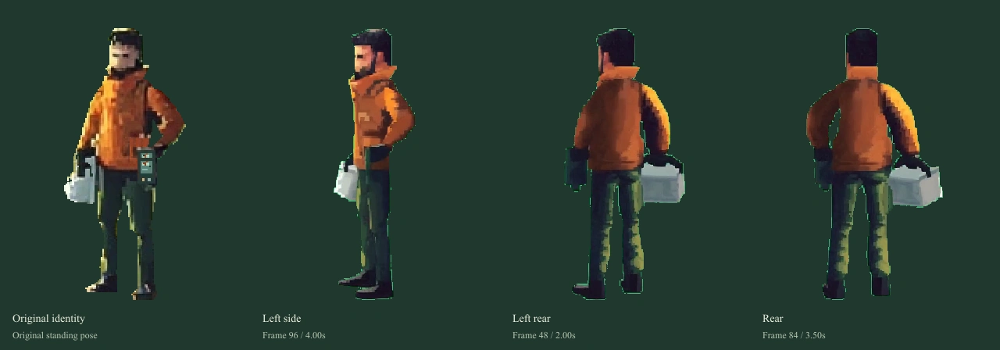

# 下一步动作小样 · 2026-10-28

**最新评审结果：旧动作小样美术未通过。** 当前先做[完整站姿精修与对照](homepage-standing-study.md)，用户认可人物完整造型后再继续动作。后文和旧验证记录为过程档案，不能解读为美术验收通过。

**最新实际交付：** 已制作[人物动作小样 01](homepage-motion-prototype.md)：左右各 24 帧、19 帧换步转身，以及可暂停逐帧的往返预览。采用现有本地参照、离线补绘与二维关节解算，没有新生成请求。当前仍是美术候选，裤腿材质、转身身份／光色与动作自然度待评审；正式首页未接入。以下保留此前的视频路径诊断与制作规格，不能解读为新小样尚未制作。

**用户要求先调研后的更新：** 不将选择限制为换视频凭据或逐帧绘制，也不立即确定通用二维骨骼。已完成[动作制作路线调研](./homepage-motion-method-research.md)，优先验证像素友好的二维绑定、离线烘焙和少量修形；三维预渲染与姿态提取作为备选／辅助。具体工具、许可证与实际效果仍需小样验证。本轮未安装软件或生成媒体。

**当前阻塞已确认：** 继续制作时检查现有 MMX 登录和配额，当前为 OAuth；视频的日／周总数均为 0，日／周状态均为 3。MMX 自带文本配额面板明确显示“**不在当前套餐中**”。JSON 中的“100%”不能解释为可用视频额度；这不是确认可以通过等待重置恢复的额度耗尽。本次未再次提交生成，新增图片调用、视频创建请求与任务均为 0。已向用户确认接下来是在本机配置支持视频的凭据，还是改用逐帧绘制路线；不要求在聊天里提供密钥。安全状态记录见 [motion-proof-status.json](../prototypes/visual-direction/art-pack-media/motion-proof-status.json)。

继续第一阶段，先解决人物动作的制作方法。动作验收前，R1、手记、坡肩和环境稿保持当前研究状态，不扩大完整场景制作。本轮没有新增图片或视频生成。

## 先纠正已有参照

逐帧解码既有 `directional-v02.mp4` 后发现，上一批独立取帧与接触表的部分时间标注未能可靠对应原片，导致“侧面”的资产实际偏背侧。原片是 24fps、141 帧、5.875 秒。本次从帧零开始解码、用精确帧号选择，避开浮点时间寻址。

| 参照 | 本次选取 | 用途 |
| --- | --- | --- |
| 原画站姿 | 原人物输入 PNG | 衣装、面容、装备与左右手基准 |
| 朝左侧面 | 第 96 帧，4.00 秒 | 固定侧向动作的造型参照 |
| 朝左背侧 | 第 48 帧，2.00 秒 | 向左远处转身的造型参照 |
| 背面 | 第 84 帧，3.50 秒 | 背面服装与装备关系参照 |

旧派生帧和旧接触表保留为过程文件，不再作为本页的朝向依据。原视频仍有反复旋转、腿部承重和交替不完整的问题，本轮没有从它拼出行走。视频成功生成不能等同于动作通过。

正确的侧向完整画布另存为 [walk-left-input-v03.png](../prototypes/visual-direction/art-pack-media/walk-left-input-v03.png)，保留原绿色背景和 768×768 画布，只是精确帧提取。上轮失败的步态请求用了旧的背侧帧作为“侧面”输入，输入准备不准确；已在来源清单中注明，不继续复用该输入。失败请求没有产生任务或视频。

## 接下来只验证一个完整负重步态

第一份样片保持朝左，不同时要求多个方向、转身、持书、接线或场景切换。人物全身和两件装备始终在画面内，相机与尺度固定。

- 右手工具箱、左手记录器，不能镜像交换。遮挡允许物件暂时不完整可见，但不能换到另一只手。
- 两次触地构成完整左右腿周期；检查接触、下沉承重、经过、抬升及另一腿接触。支撑脚在触地期间稳定，膝盖有经过过程。
- 负重臂限制摆幅；骨盆承重、肩部反向配合、躯干与头部一起连续变化。不能只动四肢，也不能平移胸腹贴片。
- 衣摆、工具箱和记录器跟随身体受力，不能分别漂浮；每帧保留统一足底基线和人物比例。
- 先单步检查，再连续播放，最后检查首尾衔接。参考帧身份、足底接触和像素尺度全部通过后，才算确定制作方法。

这里的支撑脚稳定指接入根节点位移后的**世界地面**。制作原地循环时，支撑脚应相对人物向后移动，再由世界前进抵消；不能让原地脚点和人物平移各自独立，否则仍会滑步。小样先保持固定比例，透视和坡度另验收。

侧向周期通过以后补另一个方向及停步／转身，再用同一人物拼成“走出几步 → 停步 → 转向 → 返回”的短片。反向姿态需要独立验证装备左右关系，不能直接镜像。路线里的位移再按实走距离推进步态，不靠播放速度掩盖滑步。

本轮只完成参照纠正和下一份样片规格。尚未生成新的固定侧向步态，没有恢复生产行走，也没有完成整段往返。后续一次短视频试验仍受静帧检查和已有额度约束，不在后台重试。

## 复建与核验

`node prototypes/visual-direction/build-art-pack.mjs` 现在调用本地 FFmpeg 从原片精确取帧，再用 Sharp 去背景、裁切、统一参照高度和生成对照表；不访问生成服务。来源清单包含原片哈希、帧号、秒数、派生图哈希与尚未通过的状态。旧的原片与原始生成结果未改动。

预览中的朝向按钮同步改成明确名称和帧号。通过统一批量截图入口检查实际侧向图、图注和背面切换；保留正常加载与翻阅行为。
