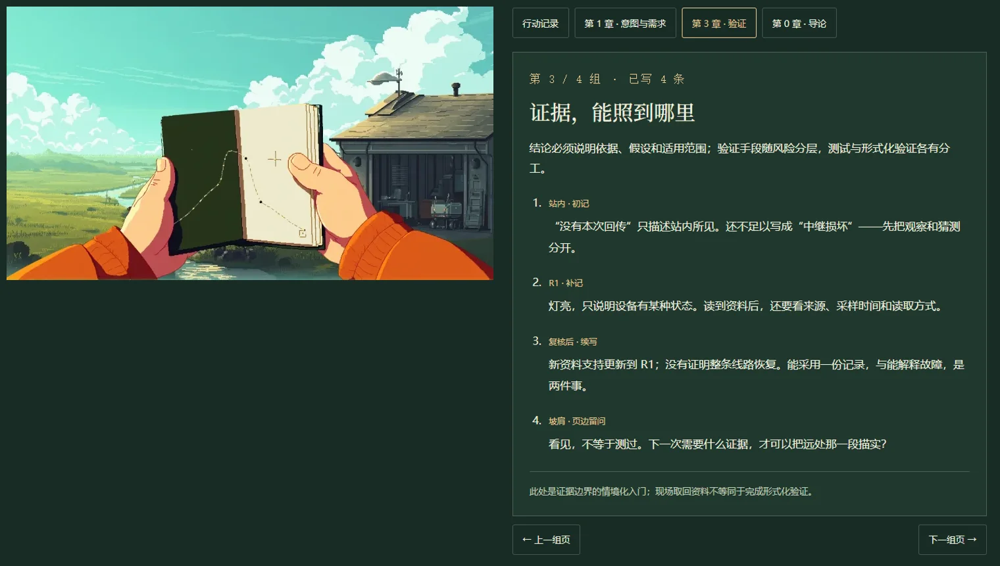

# 随探索续写的手记，与变化中的原野

2026-10-28 · 用户明确：手记应随着内容解锁／新增而续写章节的关键理念；深入未知时，气候、环境与时间也应变化。本稿接续[逐镜脚本](./homepage-exploration-script.md)，修正“只有一页点线图”的表达。

## 手记为什么值得再次翻开

这本簿既留经历，也整理从经历中理解的方法。每个理念页组可以多次续写：先留一句尚不完整的判断，后来补证据、修订、反例与下一个问题。旧字保留，新字有来处；不能每次打开只换一条任务提示，也不拿章节标题代替章节内容。

页组包含四类内容：一句明确的关键理念、对应现场的具体短记、有名称和图例的局部草图、尚未回答的问题。不是每页机械分四栏；内容决定版面。翻阅按页组移动，组内随字数自然增加纸页，生产实现需在真实阅读面积上排版，不能把六条补记无限缩进原来一张小纸。

新理念出现称为“新页”，后续经历形成“补记／续写”。“已写入”不等于“读完”或“掌握”；不做章节答题、经验值或强制阅读。完整书籍始终直接开放。场景中的短摘记和长文阅读保留原地点与书签；主动查原文，不将“翻开手记”变成跳离首屏的导航。

人与载体共享证据及对应理念。人的簿用观察、草图与反思；机器在实体记录器里按任务、来源、采集与授权追加资料，同时能对照其对应原则。两者不是同一本纸簿换肤。排演的双视角用于对读内容，不是正式设备美术。

## 第一段：真正写得出来的四组页

| 页组 | 首次写入 | 后来怎样续写 | 对应原章 |
| --- | --- | --- | --- |
| 雨后的第一份回传 | 接下 R1 委托：带回什么，范围到哪 | 站内基线 → 本地新资料 → 采用回执 → 未测线索 → 下一份草案 | 行动记录，不占一个章节名额 |
| 先说清，要带回什么 | “去看看”太含糊；写清目标、边界、可核对的完成依据 | 任务完成仍可保留未知；新问题另建委托，不偷偷改大旧任务 | 第 1 章 · 意图与需求 |
| 证据，能照到哪里 | “站内没有新回传”不足以断言“中继损坏” | 灯亮不是可信依据；核对来源／时点／读取方式；采用到 R1 不等于全线修复；目视不等于测量 | 第 3 章 · 验证 |
| 采到以后，还要由谁决定 | 带回候选资料，复核并授权采用 | 后续在实际配置变更中再补“系统检查可独立否决”，最后补长期委托的边界 | 第 0 章 · 导论 |

具体文字在[排演内容模块](../prototypes/visual-direction/story-notebook.mjs)。它们是依据原章关键原则写的情境化短记，不是原文引述。现场资料核对仅引入证据与结论边界，不能宣称做过形式化验证；系统门禁也不能由一次人工点击冒充。

草图只承担可解释的信息。例如站房、R1、反光点均需标注；实线注明“本次已采用资料到 R1”，虚线注明“委托范围／未测线索”。两份样本的比较应画来源与采样时点，不能用几颗点表达所有章节。生成图里的无字草图仅是物件研究，最终文字和图例由真实 DOM／SVG 承载。

## 全书理念如何沿三段故事逐步出现

下面是后续内容规划，只有第一段接入了内容排演。不是已完成全部章节探索，也不要求按章号依次经过十个地点。

| 原章与关键理念（概括） | 有资格写下它的经历 | 后续补记方向 |
| --- | --- | --- |
| 0 导论：Agent 执行、人给意图与裁决、系统保证可否决 | 第一段采集后授权采用；第二段实际检查失败阻断配置采用 | 第三段人离开工位，执行仍受授权范围和门禁约束 |
| 1 意图与需求：目标、边界、验收可判定，并随发现修订 | 接下有明确范围的委托 | 新问题形成新目标，旧记录不被静默改写 |
| 2 设计与架构：责任边界、接口契约与不变量先于实现 | 第二段两装置同名，对比改名／新增身份与旧档映射方案 | 画实体身份—资料来源关系，记录为何不能混淆；设计失败恢复路径 |
| 3 验证：结论依赖假设、证据和范围；风险驱动分层保证 | 第一段引入证据边界；第二段检查身份唯一、旧档可追溯等明确性质 | 给状态与性质可检查表达，出现反例时保留；不把普通现场观察称作数学证明 |
| 4 实现：按既定契约落地，错误和边界行为可理解、可检查 | 第二段由 Agent 根据选定方案修改标识配置和映射 | 对照改动前后，记录未越过的边界和可撤回点 |
| 5 测试与质量保障：具体场景反馈、风险优先、故障可复现 | 第二段试运行新来源并存、旧记录回查、断开／重试、撤回等场景 | 首次失败轨迹保留，修正后重跑；只通过一个案例不能代表全局正确 |
| 6 集成与交付：局部变更进入共同版本须过门禁、可回滚 | 第二段试运行通过后，明确授权将新映射用于站端 | 记录候选、采用版本、检查结果、回执与回滚依据 |
| 7 持续演进：运行信号回流意图／设计，改进和回归资产同步 | 第三段重复巡检出现一次异常，停止扩大工作，回站请求裁决 | 人给新意图后修订任务与检查，再看下一轮是否仍满足范围 |
| 8 工具与技能生态：工具随任务选，说明能力、权限与边界 | 选择本地读取工具，第二／三段真正配置可复用执行能力时形成理念页 | 工具替换时契约仍成立，不堆工具名和收集图鉴 |
| 附录：清单、术语与反模式是可查辅助 | 在相关页旁查到正在使用的术语／核对项 | 逐步留可回查的案例索引，不把附录造为最后一个景点 |

后两段还需逐镜展开到与第一段相同的具体程度，才制作对应“解锁”。先设计真实事件，再写短记；不先填满章卡，事后硬编理由。

## 环境变化应当带来什么

深入未知，首先是地点变化：站边有维护的路、檐下防护与可回查记录；坡肩风更暴露；再远处设施更稀，路面更难辨，记录也更不完整。原野保持可见，不必越未知越黑。近处湿草、远坡低云、设施维护痕迹与人的装备共同表达生活环境。

同一趟短途行走改变的是局地条件和光线细节。完整气候是这个地方长期偏凉、多风、易有降水的背景；晴、雨、雪是具体天气。不能走几十米就从夏日切到暴雪。雪景适合后续明确的较高地带或较冷季节委托，需要预先交代海拔／季节、地表、装备与行动限制。

| 故事段落／地点 | 时间、天气和空间 | 行动受到什么影响 | 手记多出什么 |
| --- | --- | --- | --- |
| 第一段 · 站前与檐下 | 雨后午后，云隙放晴；草叶、屋檐残水，维护路清楚 | 干处整理，核对旧缓存 | 当前环境与样本采样时点分开；雨只是背景，不自动成为故障原因 |
| 第一段 · R1 水道边 | 同一午后，离开建筑遮风；地面潮湿，端口有罩 | 沿维护路接近，在罩下读取，不站进水中 | 记录来源和采集方式，物理抵达不等于通信恢复 |
| 第一段 · 坡肩 | 短途之后，风增大、视野展开；远坡低云尚未压到近处 | 停步观察，距离限制辨识 | 记下看见的反光及未完成的定位，已知与未知并存 |
| 第二段 · 远处装置 | 下一次委托经明确转场进入；偏晚午后，低云从迎风坡接近；设施维护更少 | 先定位、核对实体身份；阵雨来时在实体遮蔽下连接，不把湿手直接操作画成常态 | 观测条件与异常来源分开记录，能见度差不能直接解释标识冲突 |
| 第二段 · 回站试运行 | 雨势减弱后返回，傍晚斜光；檐下工位仍在原位置 | 在工位核对改动、运行失败场景与撤回，再申请采用 | 设计取舍、失败轨迹、配置版本与采用范围 |
| 第三段 · 留给下一班 | 另一个明确的交接片段，蓝调时段至入夜；窗内／檐下稳定暖光，水面接光 | 人整理收簿并让出工位；载体沿已确认线路执行，异常等待确认 | 系统独立工作留下新的资料；人的下一次翻阅能看出离开后发生了什么 |
| 后续可选冷季委托 | 转场交代冷季或高处，积雪改变地表与维护痕迹，风雪降低辨识 | 穿戴、停靠、防护与可行路线随之变化 | 留下环境条件、任务调整与尚不能作出的结论；当前不制作此支线 |

这些属于具体制作提案，尚未成为天气资产或生产玩法。第二段低云与阵雨不是对故障原因的剧透；也不强制每段必须有雨。天气与时间提供变化和行动条件，不能变成重复“坏天气—修机器”的固定套路。

## 时间、保存与镜头连续性

叙事时间由离站、抵达、返回、进入下一份委托等明确事件推进。较大的变化先有“整理后／下一次出发”等转场；同场所的变化可用过云、滴水减少、草地阴影位置等连起来。玩家可跳过过渡，仍抵达同一结果状态。夜景必须有同构图照明稿，不能靠压暗日景。

不按电脑时钟强行入夜，不要求玩家挂机等天黑。阅读、暂停、后台和刷新不偷偷推进天气或任务；结束阅读回到相同地点、时段、天气阶段。正式存档需同时保存任务轮次、位置、环境阶段、证据、已写条目、书签与已读新增提示；角色切换不重置这些共同事实。

风在云、旗、草、水上方向一致，强弱依地点而变；檐灯只在需要照明的时段承担光照，设备采样灯独立。较远环境减少细节和高频动态；离屏、阅读与后台暂停昂贵绘制，减少动态时保留当前天气与光照的静态结果。先用环境关键帧验证变化，再拆层；本次没有图片或视频生成。

## 本次排演实际改动

独立[排演页](http://127.0.0.1:4395/story-rehearsal.html#notebook)新增可翻阅页组及按证据累积的补记。已经走过的内容可回看；同一事件只留一次；切换职责使用各自表述，仍共享来源。新内容不会把当前阅读页强行翻走，主动选择纸签或上／下组页才改变页组。重启排演清空本轮草稿；本原型仍没有持久化，不读写生产存档。

每镜新增明确标识的环境脚本文字，检查地点、天气、时段与行动后果，上方画面不伪装成已实现天气。关键帧研究页也已注明点线仅为物件研究，并链接到内容排演。正式首页、书籍原文和既有生成图保持原状。

## 检查与对照

左侧已经研究封皮、纸叠和接触，但图上的无字草图不足以表达理念；右侧补上可读理念、具名来源和连续补记，仍是功能排演的平面文字区，没有达到左图的持物和光色表现。两者尚未合为成品，下一次物件稿必须按这些真实短句与自然分页重新调整持有角度，而不能再只做点线草图。

20 项流程检查覆盖首次写入、读取失败不造证据、暂存不等于授权、后续补记保留旧字、重复提交／下一份草案不重复追加、回看与返回保留、双职责共享证据但表述不同、显式重启清空本轮。两个模块的语法检查与 diff 空白检查通过。

浏览器通过统一 `scripts/shot.mjs --batch` 截取 1440px 桌面、390px 手机与环境说明三张图；准备脚本核对上／下页与纸签、主动翻页后的标题焦点、职责切换的页组书签、重启和横向溢出。正文 16px，正文／次级文字／强调文字在页底色上的计算对比度分别为 10.86:1、7.65:1、7.59:1。单一自有 Chrome 按 PID 树收尾并移除 profile，记录残留进程 0；未做读屏器人工测试，不据此声称完整可访问性验收。

本轮使用 modern-web-guidance 的 accessibility 指南：纸签与翻页用原生 button，当前页以 aria-current 表示；只在主动翻页后把焦点移到对应标题，不把整个手记作为实时播报区。无新增动画或生成服务调用，不重建生产站点。
