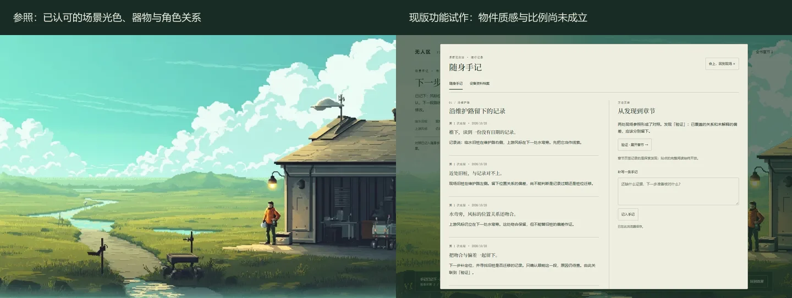

# 手记与设备档案：物件、画面与阅读

2026-10-28 · 配套[剧情脚本](./homepage-exploration-script.md)的美术规格。当前线上双栏手记只是功能试作，用户已否定其质感与风格；本规格尚待物件稿检验。

后续已进入[关键画面研究](./homepage-keyframe-study.md)：持书前景合成与边界宽景均为待评审候选，具体偏差和生成用量独立记录。下文“不在本轮调用生成服务”指此前脚本与规格阶段。

**内容校准：** 用户明确手记需随探索写入、解锁并续写各章关键理念，详见[内容与环境推进](./homepage-notebook-and-world-progression.md)。物件稿内的无字点线只研究持握，不能当作成品内容。后续姿态需让真实短句、图例与补记可读；组内内容增长自然分页，不把所有内容挤在同一张纸。理念页和行动记录共同构成随身簿，不再把方法纸签只做成章节入口。

## 现版的问题

大块平涂米色、对称双栏、规则分隔线和统一按钮组成的是网页信息面板。缺少封皮、纸叠厚度、装订、手的接触、光向和持有关系；切到深绿也仍是同一界面。记录中不断解释“从发现到章节”，使物件像章节入口的包装。将整章原文塞进同一个视窗，又让随身记录变成小号阅读站。

纸张颜色不是主要缺口。应先设计这是什么物件、平时怎么携带、在哪个动作打开、这次行动究竟留下哪一笔。

对照中，左侧器物有朝向、接地、遮挡与冷暖转折，右侧只有整齐的平面栏位。原版的纸色、字号和 DOM 可读性可以作为功能经验，不能当作材质、美术或物件比例的验收。新稿首先补足接触与体积，其次才调翻页和控件。

## 人的随身簿

**形制。** 薄的软封皮野外工作簿，合起后可放进已有工具包侧袋；尺寸以角色手掌和原画记录器为参照，先在同尺度物件稿中检验，不预设夸张的大开本。封皮深灰绿，露出暖灰白纸边，布脊与少量折角说明长期携带。磨损集中在角、折线与指触区，避免均匀做旧、泛黄噪声、羊皮卷和装饰性蜡封。

**画法。** 与原画统一的成组像素、斜向受光与冷色背光。纸叠和封皮轮廓用少量有节奏的阶梯边；体积由页根遮蔽、封皮翻折和手部接触阴影形成。纸面是相对安静的大色块，细节围绕草图与修订集中。不能用 CSS 米色矩形加颗粒滤镜宣称材质完成。

**镜头。** 行进时收起，观察时短暂记一笔，主动翻看才进入持书近景。打开过程经过封皮和第一页，不从画面中央凭空长出整块大窗。桌面目标画幅下保留一侧现场和远景方向，书页字不能为了露景而缩得过小；短窗口改为工位上的平放近景与单页。减少动态时直接抵达同一最终画面。

**内容层级。** 任务与沿途观察组成行动记录；关键理念另有可翻阅页组，经历到来时初写，后续补证据、修订与问题。第一段涵盖目标边界、证据范围与采集／裁决职责。草图必须有对象和解释，不能用无字点线替代这些内容。每次打开记住原页；新增不抢走正在阅读的页。旧笔迹保留、修订有来源，别每次重置成一个自动生成列表。

**文字。** 正文为真实 DOM，约 16–18px 中文起步、短句与充足行距；少量编号与时间使用小号等宽。手写感用于草图、圈点和短注，不能用不可读的假字或整页手写字体。纸张与手、页边用美术资产，正文不烘焙进图像。

**操作。** 页角／纸签负责翻页与方法索引，底部保留可发现的上页、下页、合上按钮及键盘路径。翻页改变的是一个可辨页组，不做无尽滚动的档案列表。无需强求逼真的布料／纸张物理；短的遮挡翻页或剪辑足够，接触关系必须成立。

## 机器的资料载体

**物件。** 在现有记录器和站端工位上选择可辨认的屏幕／端口，不另造悬浮霓虹大屏。载体接入时以线缆端点、停靠位置或端口接触交代资料从哪里来。暗部是壳体凹进去的显示区，亮度受白天天光影响，不能一切换就全屏夜色。

**组织。** 一次任务是一份资料束：委托、基线、采集、授权、回执。默认只展示本次新增与待确认项，原始长记录主动展开。来源、采样时点、接收时点和范围可分别核对；追加记录显出与原条目的联系，而不是两份内容重复排列。

**动效。** 屏幕变化发生在连接、读取和收到回执时；状态灯服务于实际采样或等待，没有全程同步呼吸。新增条目落入既有资料束后保留，不每次切视角都重新播放。

**区别。** 人会画出路线和疑问，机器保留来源与执行事实；同一证据能互相追溯。移除手记上方“随身手记／设备资料档案”的换肤标签，使用人物随身物件和站内设备两个实际入口。

## 方法与长文

探索留下的短句和草图是第一页内容。方法纸签可以呈现“本次目标有什么边界”“新资料能够支持到哪里”等经历对应的摘记，随后再允许在同一场景打开长文。

长文采用清晰的沉浸阅读层：保留所在物件、原页书签与合上返回位置，正文给足宽度和字号；不强塞在窄小的拟物纸页上，也不要求用户做数十次翻页才能读完。按需加载，原章不改写，关闭回到打开前的页和机位。长文的可读性与短手记的物件感分别处理。

## 待制作的最小物件稿

| 稿件 | 要看清的关系 | 通过依据 |
| --- | --- | --- |
| 工位同尺度摆放 | 簿、记录器、手掌、工具包 | 能携带，手能接触，身份连续 |
| 持书近景：接下委托 | 封皮、布脊、纸叠、未完成草图、远处现场 | 不读标题也能认出这是随身工作簿 |
| 同机位：带回资料后 | 旧线、新笔、来源与范围 | 两张并排能指出行动留下哪一笔 |
| 设备连接近景 | 载体端口、接触、资料束与回执 | 看出执行与交付，区别于人拿着书 |

先做上述静帧及新旧对照，评审后拆层接入。不在本轮调用生成服务，不拿脚本排演的示意线图冒充这些成品。后续优先沿用用户选定的 MMX 和原画身份参考；人物方向及动作关键帧通过后再考虑短视频，避免批量消耗。
