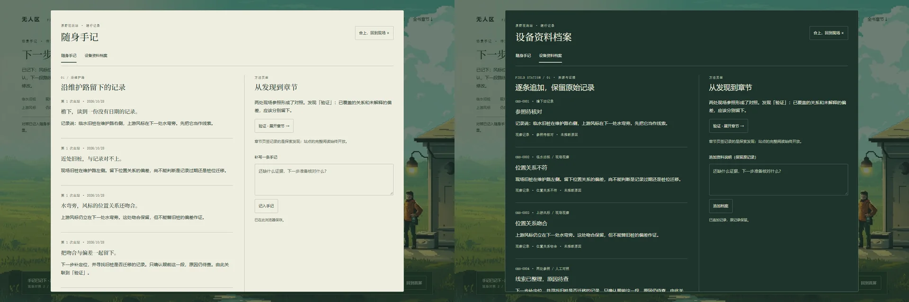

# 观测站内的手记与设备档案 · 2026-10-28

**后续用户反馈：** 本版的手记质感与风格不合理。以下保留功能试作记录，不视为已认可的美术；下一步先按[新剧情脚本](./homepage-exploration-script.md)和[物件美术规格](./homepage-record-art-direction.md)制作连续分镜及持书／设备近景。

用户指出“翻开手记”跳往普通阅读页破坏场景连续性，并提出人的探索记录与章节发现、机器的资料追加应有不同载体。本轮沿用已认可原画，接通同一现场内的记录流程，没有增加图片或视频生成调用。

## 本轮行为

“翻开手记”打开纸本记录；点击站内设备则打开资料档案。合上仍在同一现场，不改变地址或退出观测站。纸本按出站次数、日期和叙事标题组织，设备档案保留 OBS 序号、来源和核对关系。两种载体共享现场证据，补写追加新记录，不覆盖此前内容；这是记录载体的区别，尚不是两个完整的角色行动模式。

查阅旧记录、观察临水旧桩和上游风标时分别留档，同一次核对不重复追加。看完两处参照后，仍须主动“留下待查线索”，才能在手记发现“验证”。只确认关系的吻合与偏差，原因保留待查。显式重新核对开启新一轮，旧记录与已发现章节保留。

章节按需从现有正文取出，在手记内展开，保留标题、段落、列表、表格和代码；不嵌入整页导航、脚本或页面控件。章节读取失败可返回重试，合上会取消未完成的请求。站点直接阅读与十章目录继续开放，探索发现不作为普通阅读的门槛。当前只接通“验证”这一条线索，其他章节尚无探索内容。

记录与章节发现在当前浏览器本地保存，不上传。刷新后保留历史，开始新一次出站；当前页面跨桌面／手机断点时保留核对状态。存储不可用时显示提示，本次页面仍可记录。资料追加由用户触发，不宣称已有机器人自主采样、自动推理或远端同步。

## 视觉与运行

左为纸本双页与中缝，右为设备深绿档案与来源编号；背景仍能辨认同一观测站。纸本的段落节奏和设备的资料密度分别服务阅读与追溯，未引入新的画面风格或角色素材。

对照已认可的观测站原画，配色与细边框连续；记录文字使用可读 DOM，未追求人为像素化字体。当前表现仍是双页阅读界面，尚无实体书的翻页动作、持书姿态或设备操作动画，不能据此宣称场景玩法已完成。

原生 dialog.showModal() 提供顶层、背景不可交互、Tab 焦点约束、Esc 关闭与焦点返回。模态内部及 backdrop 阻止滚动穿透，针对本站旧有 body 滚动锁做局部撤销，避免根滚动条消失导致画面位移。打开手记暂停环境绘制和镜头动效，关闭遵循原有用户暂停选择；移动断点销毁场景资源时也关闭手记。

## 验证

构建成功，21 个资源引用有效，十章生成正文与源文件逐字节一致。首页、加载生命周期、控件水纹和手记流程合计 101 项检查通过，涵盖原生键盘操作、来源与去重、主动发现、追加后旧记录不变、用户文本作为纯文字、章节标题和代码完整、768px 短窗口与 2560px 视口、断点往返、刷新持久化。展开的“验证”正文为 3657 个文本字符，不用任意长度阈值替代原章节结构检查。

截图通过统一 batch 入口，共六张；首批在第四张准备表达式出错后已精确清理，只重跑剩余两张，最后修正隐藏锚点文字后补拍一张章节页。两个截图批次及行为测试均按自有 Chrome 进程树与仓库 profile 清理，残留进程为 0。功能检查与截图不代替用户对手记美术、玩法深度的评审。

应用 modern-web-guidance 的 dialog 与 prevent-page-scroll-under-modal-dialog 指南：使用原生模态与原生关闭，不自行重建焦点陷阱；在 backdrop 设 overflow:hidden 和 overscroll-behavior:contain，不用 body 固定定位锁住整页。

