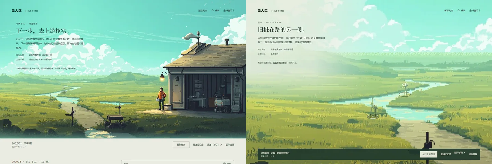

# 首屏内交互、设施动态与持续负载 · 2026-10-27

用户指出：操作区落到首屏外；灯与屋顶设施静止；打开一段时间可能卡顿；仍只有点击。此次修正保持认可原画与角色身份，补取景移动与环境动态，人物行走仍未完成。

## 场景边界与镜头

桌面首屏改为视口高度，操作区固定在画面内下缘，使用与观测站一致的深绿半透明底；不再把控制区或平板手记排在画面下方。手记留在画面左上方，衬底只覆盖文字周围，草地与岸边不整片泛白。短窗口中的长手记局部滚动，控制区保持可达。

同一张原画作为一个整体，通过合成层镜头取景实现“全景 → 工位 → 临水旧桩 → 上游风标 → 回看两处参照”。照片与热点共享同一坐标系，无逐帧DOM布局。连续操作从当前可见取景接续，调整窗口重新计算边界，镜头不露出画外空白；聚焦现场按钮也会将对应测点带入视野。暂停、搜索及减少动态设置会结束镜头过渡。

这里的移动是取景推进，人物依旧在原画位置，不能称为已实现行走或自由探索。之前因缺少方向素材撤下的错误朝向步态不会恢复。本轮没有调用图片或视频生成服务。

## 设施动效

屋顶造型从单张原画无法完全确定，按硬质风向标与上部测风转子组织，尾翼改变绕竖轴偏转的投影宽度，转子独立运动，不采用布料波纹。从原画提取轮廓，将被遮住的天空补回，避免原物件与动态图层重叠。

檐灯玻璃与邻近墙面具有缓慢暖光起伏，灯架固定。机器屏幕约2.4秒一轮采样亮起，另一状态灯约3.2秒一轮短亮，不让整个设备或站房同步闪烁。三类动效均共享已有时间、暂停和降级机制，实际像素变化单独核验。

新遮罩把设施轮廓放进Alpha通道，背景编码为128、设施编码为255，防止图像解码器丢失完全透明像素内的RGB环境通道。仍为三张纹理与一次绘制；遮罩约37KB。

## 性能策略与证据边界

旧版本机2K视口持续运行约120秒，保留JS堆增长约13KB，未记录到长任务，DOM与纹理数量稳定。因此没有在此条件下复现“打开越久越卡”，不能断言用户机器上的GPU、温度或其他页面负载已经被排除。上一轮两秒测到60fps的依据确实不足以证明长期表现。

修订版默认30fps，缓冲上限1152×648；相对60fps、1440×810的完整动态像素预算下降68%。这是绘制预算，不能等同于实测GPU耗时或整机功耗下降68%。连续90个渲染间隔内多次错过预算时，下调到896px宽；仍然持续掉帧，再下调到24fps，不自动来回升档。

静态原画由原生图片保留清晰度，透明环境画布只覆盖动态区域；完全静态区域提前结束着色。水面只叠加高光，不拿小缓冲内的位移副本覆盖原水边，避免双重轮廓。关闭光栅深度、抗锯齿和DPR倍增。离屏、后台、搜索和手动暂停均停绘，手机仍免加载交互、遮罩与WebGL模块。

持续运行通过 `node prototypes/visual-direction/browser-check.mjs --home-soak`，基线加 `--baseline`。同一个有明确PID归属的Chrome测试，每10秒记录帧间隔、JS堆、DOM计数和主线程任务时间，结束时显式GC比较保留堆；基线120秒，修订版180秒。结果位于 `.lab/home-soak-before/` 与 `.lab/home-soak-after/`。这不是用户设备上的实机复现，也不包含硬件GPU计时或温度读数。

本机结果：修订版180.2秒保持约30fps，末段P95帧间隔33.6ms，三张纹理和1152×648缓冲稳定。主线程任务占时间由基线2.98%降至1.84%，保留JS堆增长18.8KB、长任务0、DOM计数稳定。两次运行时长不同，数字用于本机趋势核对，不据此宣称已找到用户设备卡顿的唯一原因。

首页54项检查通过，覆盖首屏内操作区、多个宽度、灯／机器／风标各自动画相位、镜头状态、键盘、原记录流程、实际云层位移、离屏及静态降级。自有测试页内另施加9秒持续主线程压力，确认预算自动降档；不将该人工压力阶段混入前述持续运行指标。完整报告保留于 `.lab/survey-pins/station-revision-full-checks.json`。最后将转子取样范围限制在转子本体，避免连带尾翼上缘变形，并对设施像素单独补验。

构建与10章原文逐字节校验保持通过。截图只通过统一入口，本轮共6张；浏览器进程树与临时profile均在finally精确清理，残留0。窗口为1440×900／960与768×600／960，2K范围另用DOM和持续运行核验。

与认可原画保持相同人物、建筑与光色，变化在于画面边界、取景和操作区；进入后的衬底局限在手记附近，近处岸边保持可辨。当前差距仍是人物动作与下一片可进入区域，不能用镜头动画替代这两项验收。静帧不能展示风标、光源与帧间隔，动态由独立像素相位与持续运行记录核验。
